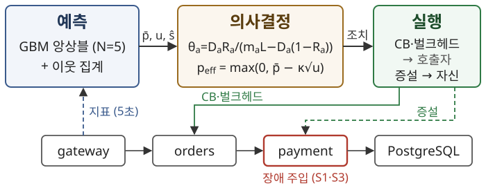

# 비용함수에서 유도한 조치별 임계값을 이용한 마이크로서비스 연쇄 장애 선제 대응

**Proactive Cascading-Failure Mitigation in Microservices with Per-Action Thresholds Derived from a Cost Function**

(저자명) · (소속) · (이메일)

---

## 요약

마이크로서비스의 연쇄 장애에 선제 대응하려면 예측이 불확실한 상태에서 성격이 다른 조치 가운데
무엇을 언제 걸지 정해야 한다. 본 논문은 위험 확률·앙상블 불확실성과 조치별 즉시 비용·가역성·
완화효과로 기대비용을 정의하고, 조치별 개입 임계값을 비용함수에서 유도하는 정책을 제안한다. 실측한
즉시 비용으로 유도하면 서킷 브레이커는 임계값이 0 에 가까워 상시 장전되고, 증설은 DB 커넥션 예산이
빠듯한 설정에서 커넥션 고갈과 하류 지연 모두 임계값이 무한대가 되어 자동 배제된다. 쿠버네티스
실측에서 증설은 커넥션 예산이 레플리카 수와 풀 크기의 곱보다 작으면 장애가 없어도 처리량을 53.5%
낮췄고, 같은 설정의 HPA 는 예산에 따라 처리량을 25% 낮추거나 60% 높였다. 불확실성 할인은 선별 투입
결정의 보류를 실행당 평균 8.8%p 늘렸으나(17회, 95% 신뢰구간 6.6~10.9%p) 비용 감소는 확인되지 않았다.

**키워드**: 마이크로서비스, 연쇄 장애, 선제 대응, 예측 불확실성, 오토스케일링

---

## Ⅰ. 서론

마이크로서비스 아키텍처(MSA)에서는 한 서비스의 지연이 호출 사슬을 거슬러 전파되는 연쇄 장애가
서비스 수준 목표(SLO) 위반의 주요 경로다. 대응 수단은 호출을 끊는 서킷 브레이커(CB), 동시 호출 수를
제한하는 벌크헤드, 레플리카를 늘리는 증설(scale-out), 부가 기능을 생략하는 브라운아웃처럼 성격이
서로 다르다. 상류에서 보이는 증상이 같아도 원인에 따라 맞는 조치가 갈리고, 틀린 조치는 무조치보다
나쁠 수 있다.

장애를 예측해 먼저 대응하면 사후 복구에 없는 두 제약이 생긴다. 예측이 빗나가면 정상 트래픽을 잃고,
조치가 효과를 내기까지 시간이 걸린다. 현장의 기본값인 CPU 기반 수평 오토스케일러(HPA)는 증설 하나만
쓰며, 병목이 DB 커넥션 같은 공유 상태 자원이면 증설이 상태를 악화시킬 수 있다.

본 논문은 조치별 개입 임계값을 비용함수에서 유도하는 정책을 제안한다. 기여는 셋이다. (1) 실측 즉시
비용만으로 CB 는 상시 장전, 증설은 자동 배제되고, 벌크헤드는 완화효과가 손실의 64% 를 넘을 때만 선별
투입됨을 유도한다. (2) DB 커넥션 예산이 레플리카 수 × 풀 크기보다 작으면 증설이 장애 없이도 처리량을
53.5% 낮추며 CPU 기반 HPA 는 이 변수를 보지 못함을 실측한다. (3) 반사실 비교로 불확실성 할인이 보류를
평균 8.8%p 늘리지만 비용 차이는 유의하지 않음을 보인다.

## Ⅱ. 관련 연구

GRAF[1], DeepScaler[2], AGQ[3]는 그래프 신경망으로 서비스 의존 관계를 반영해 자원을 선제
할당하고, FIRM[4]은 SLO 위반 서비스를 지역화한 뒤 강화학습으로 저수준 자원을 재할당한다. 이들의
조치 공간은 자원 프로비저닝 한 축이며 예측 불확실성을 쓰지 않는다. Safe Remediation[5]은
앙상블 불확실성과 가역성으로 복구 조치를 가르지만, 상류의 근본원인 분석이 끝난 뒤의
사후 복구이고, 임계값이 조치 간에 균일하며, 위험 벡터에 완화효과 축이 없다.

본 연구는 (ⅰ) 장애 이전에 개입하고, (ⅱ) 임계값을 조치마다 완화효과·가역성·즉시 비용에서 유도하며,
(ⅲ) 원인에 따라 맞는 조치가 상충하는 이질 조치를 다룬다는 점에서 구분된다. 재시도가 부하를 키워
시스템이 나쁜 상태에 갇히는 준안정 장애[6]는 DB 커넥션 고갈에서 CB 가 역효과를 내는 기전의 근거다.

## Ⅲ. 제안 방법

### 3.1 구조

제어 루프는 5초 주기로 예측 → 의사결정 → 실행을 반복한다(그림 1). 예측 계층은 노드마다 위험 확률
p̄, 불확실성 u, 병목 유형 ŝ 를 내고, 의사결정 계층은 조치별 기대비용을 비교해 조치를 고르며, 실행
계층이 이를 건다. 적용 지점은 조치의 성격에서 정해지므로(CB·벌크헤드는 호출자, 증설은 노드 자신)
탐색하지 않는다.



**그림 1.** 제안 구조

### 3.2 예측 계층

노드 시계열을 의미 기준 6개 슬롯(f1 상태성 자원 포화율, f2 큐 대기율(풀 획득 대기), f3 처리량 대비
용량비, f4 정규화 지연 p95, f5 자원 사용률, f6 오류율)으로 사상하고, 슬롯마다 현재값과 창 통계 3종을
더한 자기 특징 24차원에 이웃 집계를 합쳐 174차원을 만든다. 예측기는 부트스트랩 표본으로 학습한
그래디언트 부스팅(GBM) 5개의 앙상블[7]이며 멤버마다 시그모이드 보정을 적용한다. 멤버 확률에서 위험
확률 p̄ = mean(1 − P(정상)), 불확실성 u = var(1 − P(정상)), 병목 유형 ŝ(정상을 뺀 클래스의 argmax)를
얻는다. GBM 은 특징 중요도로 최소 관측 집합을 추릴 수 있어 택했다(5.4절).

### 3.3 의사결정 계층

위험 확률 p, 장애 시 손실 L, 조치 a 의 완화효과 mₐ, 즉시 비용 Dₐ(정상 트래픽 손실 비율), 가역성
Rₐ(되돌리기 난이도, 0~1)로 기대비용을 정의하고, E[비용 | a] < E[비용 | 보류] 를 p 에 대해 풀어
조치별 임계값 θₐ 를 얻는다.

```
E[비용 | a]    = p·[ (1 − mₐ)·L + Dₐ ] + (1 − p)·Dₐ·Rₐ
E[비용 | 보류] = p·L
θₐ = Dₐ·Rₐ / ( mₐ·L − Dₐ·(1 − Rₐ) )
```

분모가 0 이하이면 어떤 위험도에서도 보류를 이기지 못하므로 θₐ = ∞ 이고, 그 조치는 외부 규칙 없이
배제된다. 즉시 비용을 장애 시(D_f)와 정상 시(D_n)로 나누어도 분자가 D_n·Rₐ 이므로 D_n ≈ 0 인
조치의 임계값은 여전히 0 이다. 신뢰도는 불확실성을 할인한 위험도 p_eff = max(0, p̄ − κ·√u) 로
반영한다. 엔진은 리드타임 ℓₐ 가 예측 지평 L_pred 보다 짧은 조치 가운데
p_eff 에서 기대비용이 가장 낮은 것을 고르고, 보류보다 낮지 않으면 보류한다. κ 와 Rₐ 는 측정 대상이
아닌 정책 파라미터다.

## Ⅳ. 실험 설계

**대상 시스템.** gateway → orders → payment → PostgreSQL 16 의 호출 사슬을 Spring Boot 단일 이미지로
구성했다. 호출마다 최대 3회 시도(지수 백오프)하고, payment 는 커넥션 풀 20 개(획득 대기 한도 1초)로
요청당 약 63ms 동안 DB 커넥션을 점유한다. DB 의 max_connections 는 30(앱용 27)이다. 부하는 폐루프
생성기이고, 한 셀은 예열 60초 → 정상 50초 → 장애·조치 70초다.

**장애.** S1(DB 커넥션 고갈)은 payment 의 DB 연결을 끊은 뒤 외부 세션 24 개가 앱용 슬롯을 점유하게
하고, S3(하류 지연)은 payment 의 응답을 지연시킨다(측정 셀 400ms, 코퍼스는 강도를 달리함). 두 장애는
상류에서 같은 증상(payment 지연)으로 보이지만 맞는 조치가 다르다(S1: 벌크헤드, S3: CB). 틀린 조치의
손실도 실측됐다 — S3 에 벌크헤드를 걸면 p95 가 4배(481 → 1,873ms), S1 에 CB 를 걸면 128 워커에서
입구 오류율이 36% 였다(셀 전체, 각 2회).

**환경.** (E1) Docker Compose(4 vCPU VM)에서 예측기 코퍼스와 정책 비교를, (E2) 단일 노드 쿠버네티스
(minikube, v1.37, 6 vCPU·8GiB VM)에서 증설과 HPA 를 측정했다. 둘은 같은 Apple M2 호스트·이미지·설정
이며, 32 워커의 무조치 처리량이 317.9 대 323.0 rps(1.6% 차이)였다. HPA 는 payment 에 최소 1·최대 4·
CPU 60%(요청 100m)로 걸었다.

**예측기 평가.** 코퍼스는 E1 의 장애·대조군 에피소드 13개와, 장애 주입과 함께 조치(벌크헤드·CB·
무조치)를 강제한 셀 21개다(S1 18·S3 14·정상 2, 32~128 워커, 10,886 표본). 장애 구간이 정상 구간보다
느려지지 않아 기준선으로 쓸 수 없는 에피소드 4개는 뺐다. 노드 v 의 라벨은 [t, t+Δ] 안에 v 가 전파에
기인한 SLO 위반에 빠지면 그 장애의 유형(S1·S3), 아니면 정상이다. 에피소드 단위 4접기 교차 검증의
접기 밖 예측으로 평가한다.

**측정.** Dₐ 는 장애 없이 조치만 강제한 셀의 처리량을 무조치 셀의 같은 구간(조치 후 +10~+70초)과
비교해, mₐ 는 장애 아래 같은 비교로 얻는다. E1 에서는 A2(규칙: p̄ > 0.5 이면 벌크헤드)·A4(무조치)·
A5(제안, κ = 1)·A6(κ = 0)을 32 워커 S1 에서 폐루프로 돌리고(예측 지평·L_pred 30초), E2 에서는 HPA(A1)
를 HPA 없는 셀과 비교한다. 할인의 효과는 A5 의 같은 결정 기록에 p̄ 와 p_eff 를 각각 대입해 비교한다 —
폐루프에서는 정책마다 위험도 분포가 달라져 별도 실행끼리는 κ 가 분리되지 않는다.

**통계.** A5 는 17회, A2·A4·A6 은 5회, 쿠버네티스 셀은 조건마다 3~5회 반복했다. 상대 변화는 Welch
t 구간으로, 효과 없음은 ±10% 동등성 검정(TOST)으로 판정한다. 셀 순서는 무작위화했고, E2 는 셀마다
호스트 부하와 무관 프로세스의 CPU 를 기록했다(결과 편차와의 순위 상관 ρ = +0.01).

## Ⅴ. 결과

### 5.1 유도된 임계값

**표 1.** 조치별 파라미터와 유도된 임계값 (L = 1)

| 조치 | Dₐ (실측) | Rₐ | mₐ | θₐ | 유도된 성격 |
|---|---|---|---|---|---|
| CB | 0.002 | 0.1 | S3: 0.8 (설계값) | 0.00025 | 상시 장전 |
| 벌크헤드 | 0.716 | 0.1 | S1: 0.8 (설계값) | 0.46 | mₐ > 0.64 일 때만 선별 투입 |
| 증설 | 0.54 | 0.7 | S1: +0.004, S3: +0.003 (실측) | ∞ | 자동 배제 |

CB·벌크헤드의 Dₐ 는 E1 조치별 1셀(벌크헤드는 다른 방법으로 잰 0.703 과 일치), 증설은 E2 예산 30 의
5회 평균(95% 신뢰구간 0.43~0.64)이다.

CB 는 장애가 없으면 회로가 열리지 않아(느린 호출·실패 비율 50% 미만) 즉시 비용이 0 에 가깝고,
완화효과 값과 무관하게 임계값이 0 에 붙는다 — mₐ 가 0.1 이어도 θ = 0.002 다. 회로가 잘못 열리는 손실은
Dₐ 가 아니라 mₐ 에 들어가며, S1 에서는 mₐ < 0(설계값 −0.3)이라 CB 가 배제된다. 증설은 실측 완화효과가 0 에 가까워 분모가 음수이므로
두 장애 모두에서 배제되며, 유한해지려면 mₐ 가 0.16 을 넘어야 한다. 벌크헤드의 임계값은 완화효과에
민감하다 — 분모가 양수이려면 mₐ > Dₐ(1 − Rₐ) = 0.64 여야 하고, 설계값 0.8 에서 0.46 이다. 이는 CB 는
상시 걸고 벌크헤드는 필요할 때 조이는 현업 관행과 맞는다.

### 5.2 증설의 역효과와 HPA

**표 2.** 쿠버네티스에서 증설(1→3)과 HPA 의 처리량 변화 (같은 배치의 무조치 대비, 괄호는 95%
신뢰구간·반복 수)

| 조건 | DB 예산 30 (앱용 27) | DB 예산 70 |
|---|---|---|
| 증설, 장애 없음 | **−53.5%** (−63.5~−43.4, 5) | **+58.2%** (+56.9~+59.5, 3) |
| HPA, 장애 없음 | **−25.1%** (−38.6~−11.6, 3) | **+59.8%** (+59.4~+60.1, 3) |
| 증설, S1 · S3 | +0.4% · +0.3% (동등, 5 · 3) | — |

정상 상태의 payment 는 커넥션 20 개를 모두 쓰는 풀 포화 상태다(317.9 rps ≈ 20 × 커넥션당 15.9 rps).
예산 30 에서 증설하면 기존 파드가 20 개를 쥔 채 신규 파드 둘이 남은 7 개(3 + 4, DB 에서 직접 계수)만
얻는다. 연결 단위 분산은 처리 능력이 다른 레플리카에 연결을 고르게 나눠 가장 약한 파드가 전체의
상한이 되고, 처리량이 절반으로 떨어진다(독립 재실행 −48.8%, −50.3%). 예산 70 에서는 신규 파드가
15~19 개를 얻어 처리량이 58% 오른다. CPU 기반 HPA 는 장애가 없는 정상 부하에서 payment 를 2~4개로
늘렸고, 같은 설정이 예산에 따라 −25% 와 +60% 로 갈렸다 — 증설의 득실을 정하는 변수를 오토스케일러가
보지 못한다. 리드타임 ℓₐ 는 Ready 까지 5.2초, 트래픽 도달까지 13초 이내였다.

장애 중 증설은 효과가 없었다. S1 에서는 예산이 이미 바닥이라 신규 파드가 커넥션을 얻지 못했고(HPA
도 +0.5% 로 동등), S3 에서는 처리량을 정하는 것이 용량이 아니라 지연이었다. 요청 단위로 분산하면 S1 의
증설은 오히려 처리량을 97.9% 떨어뜨려, θ = ∞ 는 분산 방식과 무관하다.

### 5.3 불확실성 할인

A5 의 17회 실행에서 병목이 S1 으로 판정돼 벌크헤드(θ = 0.46)가 후보인 결정 389건에 같은 기록의 p̄ 를
대입하면 7.1%, p_eff 를 대입하면 14.8% 가 보류였다. 실행별 차이는 평균 **+8.8%p**(95% 신뢰구간
+6.6 ~ +10.9%p, 중앙값 +7.4%p)이고 17회 모두 양수였다(부호검정 p = 1.5×10⁻⁵). 다만 할인이 비용을
줄이는지는 확정되지 않았다 — 같은 기록에 κ 만 바꿔 사후 결과로 계산한 비용은 κ = 1 과 κ = 0 이 구별되지 않았다(짝지은 t, p = 0.57). θ ≈ 0 인 CB 결정에서는
할인이 보류를 거의 만들지 못해, 상시 장전 조치의 비중만큼 효과가 희석된다.

### 5.4 예측 계층과 개입 비용

증상이 같은 S1 과 S3 를 가르는 최소 관측 집합은 큐 대기율(f2)과 정규화 지연(f4) 2종이었다(macro F1
0.937 ± 0.041, 수집한 5종 전체 0.927 ± 0.052). 표준 지표인 지연과 오류율만으로는 0.647 ± 0.139 로,
큐 대기율을 더해야 갈린다. 이웃 집계를 더하면 3클래스 macro F1 이 0.736 에서 0.887 로 오르며, 라벨
에서 상류 열화 조건을 빼도 상승폭(+0.167)이 줄지 않아 라벨과 특징의 순환 때문이 아니다.

예측기와 엔진을 이은 경로(Δ = 30초)에서 확률 보정 오차(ECE)는 0.043 이었고, 위험 확률이 0.1~0.9 인
표본이 28.2% 로 신뢰도로 대응을 나눌 여지가 있었다. 장애가 없는 구간의 정상 표본 4,821건 중
35.2% 에 조치가 나갔으나 1,691건이 CB 장전이고 벌크헤드는 4건(0.1%)이어서 표본당 비용은 0.00013
이었다. 정상 라벨에 나간 벌크헤드 102건 중 98건은 장애가 진행 중인 구간의 비전파 노드였다. 다만
정상 라벨 표본에 조치가 나간 비율은 접기마다 8~89% 로 갈렸다 — 정상 표본에도 ŝ 가 S1·S3 중 하나로 정해지고, S3 로 판정되면 θ ≈ 0 인 CB 가 후보가 되기 때문이다.

정책 비교(E1, S1)에서는 무조치 A4 의 goodput 이 196.0 rps(범위 195.7~199.0)로 가장 높았고 A2 187.6,
A6 186.9, A5 185.7 rps(범위 184.9~192.3)로 대체로 개입 빈도의 역순이었다 — 용량이 고정된 폐루프에서
호출자 측 조치는 대기 위치를 옮길 뿐 병목 용량을 늘리지 못해 비용만 남았다.

## Ⅵ. 결론

본 논문은 조치별 개입 임계값을 비용함수에서 유도하는 선제 대응 정책을 제안하고, 실측한 즉시 비용만
으로 CB 의 상시 장전과 증설의 자동 배제가 유도되며, 증설의 득실을 정하는 공유 자원 예산을 CPU 기반
HPA 가 보지 못함을 보였다. 불확실성 할인의 효과는 결정 수준(보류 +8.8%p)에서 분리했다.

한계는 다음과 같다. 실험은 단일 머신의 3단 사슬이고 장애는 세션 점유와 지연 필터로 모사해, 증설이
맞는 용량 포화형 장애는 다루지 않았고, 브라운아웃은 이 사슬에 생략할 선택 호출이 없어 측정하지
못했다. 폐루프 고정 용량 환경에서 호출자 측 조치의 완화효과가 실현되지 않아 벌크헤드와 CB 의 mₐ 는
설계값을 썼다. E1 의 Dₐ 는 조치별 1셀이고, E1 에서는 자원 사용률(f5)을 수집하지 못했다. 후속 연구에서
다단 토폴로지, 추론 노드, 용량 포화형 장애로 확장한다.

## 참고문헌

[1] J. Park, B. Choi, C. Lee, D. Han, "GRAF: A Graph Neural Network based Proactive Resource Allocation
Framework for SLO-Oriented Microservices," *Proc. ACM CoNEXT*, 2021.

[2] C. Meng, S. Song, H. Tong, M. Pan, Y. Yu, "DeepScaler: Holistic Autoscaling for Microservices Based on
Spatiotemporal GNN with Adaptive Graph Learning," *Proc. IEEE/ACM ASE*, 2023.

[3] P. Liang, Y. Xun, J. Cai, H. Yang, "Autoscaling of Microservice Resources Based on Dense Connectivity
Spatio-temporal GNN and Q-learning," *Future Generation Computer Systems*, vol. 174, 107909, 2026.

[4] H. Qiu, S. S. Banerjee, S. Jha, Z. T. Kalbarczyk, R. K. Iyer, "FIRM: An Intelligent Fine-grained
Resource Management Framework for SLO-Oriented Microservices," *Proc. USENIX OSDI*, pp. 805–825, 2020.

[5] C. Dai, Z. Yan, C. Lei, Q. Li, L. Zhang, "Safe Remediation as Risk-Constrained Intervention Decision in
Microservice Systems," arXiv:2607.20005, 2026.

[6] N. Bronson, A. Aghayev, A. Charapko, T. Zhu, "Metastable Failures in Distributed Systems," *Proc.
HotOS*, pp. 221–227, 2021.

[7] B. Lakshminarayanan, A. Pritzel, C. Blundell, "Simple and Scalable Predictive Uncertainty Estimation
using Deep Ensembles," *Advances in Neural Information Processing Systems 30 (NIPS)*, pp. 6402–6413, 2017.

---
---

# 아래는 원고가 아니다 — 작성 메모

## 원고의 수치와 출처

| 원고의 수치 | 출처 |
|---|---|
| Dₐ: CB 0.002 · 벌크헤드 0.716 (각 1셀) · 벌크헤드 독립 재현 0.703 | `code/experiment/disruptionByAction.py` (Compose 원장), challenges J19 |
| Dₐ 증설 0.54 (평균 0.535, 95% 0.434~0.635 / 엔진 배선값 0.546) | `code/experiment/results/scaleOutEffect-20261122-195336.json`, J31·J34 |
| mₐ 증설 S1 +0.004 (n=5, 동등) · S3 +0.003 (n=3, 동등) | 같은 파일 / `scaleOutEffect-j33-20261123-075826.json`, J31·J33 |
| θ: 0.00025 · 0.46 · ∞ · CB S1 설계값 −0.3 | `code/model/policyEngine.py` (지문 `aabd56a124db`), J23·J34 |
| 표 2 증설 −53.5% · +58.2% · 재실행 −48.8%·−50.3% | `scaleOutEffect-*.json` (J31 배치·예산 대조·J32 기본 코호트) |
| 표 2 HPA −25.1% · +59.8% · S1 +0.5%(동등) · 레플리카 2~4 | `hpaEffect-j32-*.json`, `hpaEffect-j33-*.json` |
| 신규 파드 커넥션 3+4 / 15~19 · 커넥션당 15.9 rps · 63ms | `scaleOutEffect-budget-20261122-225008.json` (`podConnections`·`mechanism`), J31 |
| 요청 단위 분산 −97.9% · 1초에 하나씩 | `scaleOutEffect-j32-*.json`, `code/chain/results/k8s-j32/diagnose-ka1-*.txt`, J32 |
| 리드타임 Ready 5.2초 · 트래픽 13초 · 무조치 317.9 vs 323.0 · ρ +0.01 | J31 (`contamination.foreignCpuVsDeviation` ρ = 0.014, n = 20) |
| 오선택 손실: S3+벌크헤드 p95 481 → 1,873ms · S1+CB 128워커 오류율 36% | `code/chain/results/remediation-20261013-*.json` (셀 전체 `entryLoad`, 각 2셀) |
| 게이팅 평균 +8.8%p (95% 6.6~10.9) · 중앙값 +7.4%p · 17/17 · 389건 · 7.1% → 14.8% | `comparePolicies.py --scenario s1 --workers 32 --digest c299de2c4f92`, J29 |
| κ=1 vs κ=0 비용 p=0.57 (사후 결과 p=0/1 대입) | `kappaSensitivity.py` `realisedCost`, J29 |
| f2+f4 0.937 ± 0.041 · 전체 0.927 ± 0.052 · 표준 0.647 ± 0.139 | `code/model/minimalObservation.py` (J36 회귀 확인) |
| 이웃 집계 0.736 → 0.887 · 순환 점검 +0.167 | `code/model/tierComparison.json`, `tierComparison-selfOnlyLabel.json` (J36) |
| ECE 0.043 · 중간 구간 28.2% · 무장애 4,821건 35.2% · CB 1,691 · BH 4 · 0.00013 · 정상 라벨 BH 98/102 · 접기별 8~89% | `code/model/deltaSweep.json` Δ=30 행 (J36) |
| 정책 비교 196.0 · 187.6 · 186.9 · 185.7 · 범위 | `code/experiment/results/ledger.jsonl` (S1·32워커, A5 지문 `c299de2c4f92` 17회, A6 5회, A2·A4 배선 전 5회) |
| 코퍼스 34 = 에피소드 13 + 강제 조치 셀 21 · S1 18 · S3 14 · 정상 2 · 10,886 표본 | `code/model/corpus.py` + `episodeValidity` (J36) |
| 재시도 3회 시도 · CB 느린 호출 400ms·비율 50% | `code/services/app/.../RemediationDecorator.java`, `application.yml` |

## 투고 전 검토 기록 (2026-11-24)

리뷰 에이전트 셋이 사용량 한도로 두 번 실패해(오케스트레이터 규칙: 1회 재시도 후 진행) 세 영역 —
문서 일관성·실험 설계·구현 정합성 — 을 원고 수치와 산출물을 하나씩 대조하는 방식으로 직접 검토했다.

| 등급 | 무엇이 틀렸나 | 고친 것 |
|---|---|---|
| 🔴 | **5.3 신뢰구간이 다른 통계량에 붙어 있었다** — 6.6~10.9 는 실행별 몫의 **평균(+8.8%p)** 의 t 구간인데 중앙값 +7.4%p 에 붙였다 | 평균 +8.8%p 와 구간, 중앙값을 함께. 요약·기여·결론도 8.8%p 로 |
| 🔴 | **5.4 "비싼 개입은 장애 구간에서만"** — Δ=30 에서 무장애 구간 벌크헤드 4건이 있다 | 102건 중 98건이 장애 구간의 비전파 노드라고 정확히 |
| 🔴 | **표 1 이 환경·표본 수를 숨겼다** — CB·벌크헤드 Dₐ 는 E1 1셀, 증설은 E2 예산 30 의 5회 | 표 밑에 출처·n·예산 조건, 요약에 "예산이 빠듯한 설정에서" |
| 🟠 | **"최대 3회 재시도"** — resilience4j `maxAttempts=3` 은 시도 3회(재시도 2회) | "최대 3회 시도(지수 백오프)" |
| 🟠 | 라벨 정의가 없었다 · 코퍼스의 21/34 가 강제 조치 셀임을 밝히지 않았다 | §4 예측기 평가에 라벨 정의·코퍼스 구성·무효 제외 기준 |
| 🟠 | 라벨-특징 순환(상류 열화 조건이 이웃 특징에 들어 있음)에 대한 답이 없었다 | 순환 점검 +0.167 한 구절 |
| 🟠 | 접기별 오탐 편차(8~89%)를 숨겼다 | 5.4 에 원인(ŝ 가 정상 표본에도 정해짐)과 함께 |
| 🟠 | "틀린 조치는 무조치보다 나쁠 수 있다"(서론)에 근거가 없었다 | §4 에 10-13 오선택 실측 한 문장 |
| 🟠 | **분량 초과** — 2단 근사(9pt)로 약 3.2쪽이었고, 그림 1 이 링크되지 않았으며 단 폭에서 글자가 4pt 였다 | 겹치는 표현을 줄여 3쪽 + 참고문헌 몇 줄로, 그림은 단 폭 6.5pt 로 다시 그림 |
| 🟡 | kubeadm → 실제는 minikube(vfkit, 내부 kubeadm) · CB 개방 조건 · 브라운아웃 미측정 · HPA S1 · 정책별 n · [7] 서지 | 각각 반영 |

**넣지 않은 것과 이유**
- *"실측 mₐ(벌크헤드 S1·CB S3 ≤ 0)를 넣으면 엔진이 보류로 수렴해 A4 와 같아진다"* — 공식상 참이지만 10-13
  셀은 벌크헤드 동시성 설정이 `Dₐ` 측정 셀(11-01, 6)과 같다는 기록이 없다(`cellConfig` 는 그 뒤에 생겼다).
  같은 θ 식에 두 셀을 섞을 수 없어 뺐다
- 제안서 §4-2 의 *"S1 에 CB → 입구 에러율 100%"* — 코퍼스의 10-13 셀에서는 재현되지 않는다(128워커 36%,
  32워커 1~2%). 그 100% 가 어느 셀인지 찾지 못했다. **제안서 문장을 확인해야 한다**

## 확인이 남은 것

- **참고문헌** — [1]·[2]·[3]·[6] 은 Crossref, [5] 는 arXiv 원문, [4] 는 다른 논문의 참고문헌 목록, [7] 은
  NeurIPS proceedings 메타데이터(pp. 6402–6413)로 확인했다(2026-11-24). 분량 때문에 원고에서 뺀 DOI —
  [1] 10.1145/3485983.3494866 · [2] 10.1109/ASE56229.2023.00038 · [3] 10.1016/j.future.2025.107909 ·
  [6] 10.1145/3458336.3465286. 양식이 DOI 를 요구하면 되살린다
- **§2 의 Safe Remediation 구분선** — *사후(상류 RCA 이후)·조치 간 균일 임계값·완화효과 축 없음* 은 초록이
  아니라 **본문 인용**에서 온 것이다(proposal §3 재정의된 구분선, challenges J6·J14). 초록이 직접 확인하는
  것은 위험 분해(blast radius·reversibility·epistemic uncertainty)뿐이다
- **CFP** — 투고처의 분량·양식·글꼴 크기·단독 저자 허용·**AI 활용 고지 규정**을 투고 전에 확인한다
  (후보 분량: KIICE 2~3p, KIIT 3p, KSII 1~2p — J20)
- **J35 결정 3(강제 조치 셀의 코퍼스 포함)** — 원고는 포함한 채로 쓰고 §4 에 밝혔다. 빼기로 하면 5.4 의 숫자가
  전부 바뀐다
- **그림 1** — [figure1-architecture.svg](figure1-architecture.svg). 한 단(약 84mm)에 넣으면 본문 글자가
  약 6.5pt 다(폭 700·글자 19px). 처음 그림(폭 760·13px)은 단 폭에서 4pt 로 읽히지 않아 다시 그렸다.
  흑백 인쇄에서는 증설 경로(점선)와 CB·벌크헤드 경로(실선)가 선 모양으로 구분된다
- **분량** — [measurePages.py](measurePages.py) 로 잰다(A4 2단 근사이지 투고 양식이 아니다).
  2026-11-24 기준 **본문 9pt: 3쪽 + 참고문헌 몇 줄**, **본문 10pt: 약 3.9쪽**. 투고처가 3쪽 상한이면서
  10pt 양식이면 아래 순서로 줄인다(위에 있을수록 잃는 것이 적다)
  1. 5.2절 둘째 단락의 요청 단위 분산 문장 — 기전은 J32 에 있다
  2. 표 1 아래 주석을 표 캡션으로 합친다
  3. 5.4절 셋째 단락(정책 비교)을 한 문장으로 — **빼지는 않는다.** §4 가 A2·A4 를 소개하고, 제안이
     무조치를 이기지 못한 결과를 숨기면 선택적 보고가 된다
  4. 3.3절의 D_f/D_n 문장 — J20 이 §3 에 두기로 한 대수적 성질이라 마지막에 줄인다
