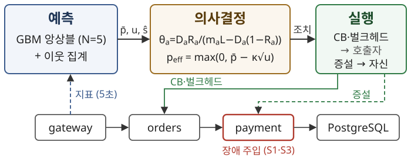

<div class="cover" markdown="1">
<p class="cover-kicker">개인 학습용 해설서 · 2026-11-25 기준</p>
<p class="cover-title">비용함수에서 유도한 조치별 임계값을 이용한<br>마이크로서비스 연쇄 장애 선제 대응</p>
<p class="cover-sub">2027 춘계 학회 원고 해설 — 무엇을, 왜, 어떻게 했고, 숫자는 어디서 왔나</p>
<p class="cover-meta">원고 <code>docs/paper/draft-spring2027.md</code> · 판단 기록 <code>research/challenges.md</code> J1~J38<br>현재 위치와 다음 할 일 <code>research/timeline.md</code> 맨 위</p>
</div>

<p class="toc-title">차례</p>

[TOC]

# 1부. 한눈에 보기

## 1.1 이 해설서를 읽는 법

원고는 2~3쪽이다. 문장 하나에 실험 여러 개가 압축돼 있어서 그것만 읽고서는 *왜 그렇게 썼는지*,
*숫자가 어디서 왔는지* 를 설명하기 어렵다. 이 해설서는 원고의 문장마다 그 배경을 풀어 쓴다.

- **처음 읽는다면** 1부 → 2부 → 3부 순서로 읽는다. 4부의 수식은 3부를 읽다가 막힐 때 펼쳐 본다.
- **면담이나 발표를 준비한다면** 1.5(말로 설명하기) → 6부(약점과 예상 질문) → 7부(원고 밖에서 알아둘 것) 순서가 좋다.
- **숫자의 출처를 확인하려면** 5부(숫자 지도)를 본다. 원고의 모든 숫자를 만든 파일이 적혀 있다.

상자는 네 종류다. 원고에 없는 설명을 이 해설서에서 덧붙인 곳은 **[해설]** 이라고 표시했다.

<div class="box key" markdown="1">
<p class="box-title">핵심</p>
꼭 기억할 내용이다.
</div>
<div class="box warn" markdown="1">
<p class="box-title">주의</p>
오해하기 쉽거나, 원고를 읽는 사람이 지적할 만한 지점이다.
</div>
<div class="box qa" markdown="1">
<p class="box-title">예상 질문</p>
심사·면담에서 나올 만한 질문과 답의 뼈대다.
</div>
<div class="box lab" markdown="1">
<p class="box-title">실습</p>
손으로 계산하거나 저장소에서 직접 확인해 볼 거리다(답은 9부).
</div>

## 1.2 한 문단 요약

마이크로서비스에서 한 서비스가 느려지면 그 서비스를 부르는 쪽이 줄줄이 느려진다. 이것이 연쇄 장애다. 연쇄 장애를
**미리** 막으려면 예측이 불확실한 상태에서 *언제, 어떤 조치를 걸지* 를 정해야 한다. 이 논문은 조치마다 *"걸었을 때의
기대비용"* 과 *"걸지 않았을 때의 기대비용"* 을 비교하는 식 하나를 세우고, 그 식에서 **조치별 개입 임계값 θₐ** 를 유도한다.

실측한 비용을 넣으면 정책 세 가지가 식에서 저절로 나온다.

- 서킷 브레이커(CB)는 위험이 조금만 있어도 건다(θ ≈ 0, 상시 장전).
- 증설은 어떤 위험에서도 걸지 않는다(θ = ∞, 자동 배제).
- 벌크헤드는 위험이 46% 를 넘을 때만 건다.

쿠버네티스 실험에서는 두 가지가 확인됐다. DB 커넥션 예산이 빠듯하면 증설이 장애가 없어도 처리량을 절반 가까이
떨어뜨렸다(−53.5%). CPU 기반 HPA 는 이 예산을 보지 못해, 같은 설정이 예산에 따라 −25% 와 +60% 로 갈렸다.

마지막으로 예측의 불확실성만큼 위험도를 깎았더니 벌크헤드 결정의 보류가 늘었다(+8.8%p). 다만 그 덕에 비용이
줄었는지는 확인하지 못했다.

## 1.3 구조 그림



- **서비스 사슬** — `gateway → orders → payment → PostgreSQL`. 장애는 payment 에 주입한다.
- **예측 계층** — 노드마다 위험 확률 p̄, 불확실성 u, 병목 유형 ŝ 를 낸다.
- **의사결정 계층** — 조치별 임계값 θₐ 와, 불확실성을 할인한 위험도 p_eff 를 비교해 조치를 고른다.
- **실행 계층** — CB·벌크헤드는 그 노드를 부르는 쪽(호출자)에, 증설은 노드 자신에 건다.
- 이 고리를 **5초마다** 돈다.

## 1.4 핵심 숫자

| 숫자 | 뜻 | 원고 |
|---|---|---|
| θ_CB = 0.00025 | 위험이 조금만 있어도 CB 를 건다 — 상시 장전 | 5.1 |
| θ_벌크헤드 = 0.46 | 위험 46% 를 넘으면 벌크헤드 (완화효과 설계값 0.8 기준) | 5.1 |
| θ_증설 = ∞ | 어떤 위험에서도 증설은 보류를 이기지 못한다 | 5.1 |
| −53.5% | DB 예산 30 에서 장애 없이 증설(1→3)했을 때의 처리량 변화 | 5.2 |
| +58.2% | 같은 증설을 예산 70 에서 | 5.2 |
| −25.1% / +59.8% | CPU 기반 HPA, 예산 30 / 70 (장애 없음) | 5.2 |
| +8.8%p | 불확실성 할인이 늘린 보류 (17회 평균, 95% 신뢰구간 6.6~10.9) | 5.3 |
| p = 0.57 | 할인이 비용을 줄였는지 — 유의하지 않다 | 5.3 |
| 0.937 | 풀 대기율 + 지연 두 지표로 S1·S3 를 가르는 macro F1 | 5.4 |
| 35.2% · 0.00013 | 장애 없는 구간의 정상 표본에 조치가 나간 비율 · 표본당 비용 (거의 CB 장전) | 5.4 |
| 196.0 vs 185.7 rps | 폐루프 goodput — 무조치 vs 제안 정책 | 5.4 |

## 1.5 말로 설명하기

**1분 버전**

> 장애를 예측해서 미리 대응하려면, 예측이 틀렸을 때의 비용과 조치가 늦게 듣는 문제를 감수해야 합니다. 저는 조치마다
> 기대비용을 비교하는 식에서 *"이 조치는 위험이 몇 % 이상일 때 건다"* 는 임계값을 유도했습니다. 실측 비용을 넣으면
> 서킷 브레이커는 항상 켜 두고, 증설은 DB 커넥션이 빠듯하면 하지 않고, 벌크헤드는 위험이 46% 를 넘을 때만 거는 정책이
> 나옵니다. 쿠버네티스 실험에서 실제로 증설이 처리량을 절반으로 떨어뜨렸고, CPU 기반 HPA 는 그 원인인 DB 예산을 보지
> 못했습니다.

**3분 버전** — 1분 버전에 다음 셋을 덧붙인다.

1. **예측기** — 그래디언트 부스팅 5개의 앙상블이고, 증상이 같은 두 장애(DB 커넥션 고갈과 하위 서비스 지연)를 가르는 핵심
   지표는 *커넥션 풀 대기율* 하나였다(macro F1 0.937).
2. **불확실성 할인** — 앙상블 멤버끼리 의견이 갈리면 위험도를 깎는다. 그러자 벌크헤드 결정의 보류가 평균 8.8%p
   늘었지만 비용이 줄었는지는 통계적으로 확인되지 않았다.
3. **한계와 다음 단계** — 단일 머신의 3단 사슬이고, 용량이 고정된 폐루프에서는 제안 정책이 무조치를 이기지 못했다.
   학위논문에서 실험 머신·서비스 6~7개·LLM 노드로 넓힌다.

# 2부. 배경 지식

## 2.1 연쇄 장애와 전파 방향

호출은 `gateway → orders → payment → DB` 방향으로 간다. 장애는 **반대 방향**으로 퍼진다. payment 가 느려지면
orders 의 스레드가 payment 의 응답을 기다리며 묶이고, 이어서 gateway 의 스레드가 orders 를 기다리며 묶인다.
결국 입구(gateway)의 사용자가 느려짐을 겪는다.

<div class="box warn" markdown="1">
<p class="box-title">주의 — 이 저장소의 "상류"는 피호출 쪽이다</p>
보통 백엔드 용어로는 *downstream service* 가 호출 대상이다. 그런데 이 연구의 라벨 코드(`code/chain/relabel.py`)는
**전파가 오는 쪽**을 상류라 부른다. 그래서 orders 의 상류는 payment 다. 원고는 혼동을 피하려고 *"하류 지연"*,
*"호출자 측"* 처럼 쓰지만, 코드와 판단 기록을 읽을 때는 이 방향을 기억해야 한다. 방향을 뒤집으면 라벨이 통째로
뒤집힌다(게이트 ① 스모크 테스트 C7 이 실증했다).
</div>

**재시도도 전파를 키운다.** 이 시스템은 호출마다 최대 3회 시도한다(지수 백오프). 재시도는 일시적 실패를 흡수하지만,
하위가 이미 힘들 때 부하를 더 얹는다. 실측에서 무조치일 때 하위 호출의 12.7% 가 타임아웃으로 실패했는데, 재시도가
흡수해 입구 오류율은 0% 였다. 그 대가로 용량의 13% 가 재시도에 버려졌다(timeline ②⁻, 2026-10-13).

## 2.2 조치 네 가지

| 조치 | 하는 일 | 구현 | 거는 곳 | 비용의 성격 |
|---|---|---|---|---|
| 서킷 브레이커(CB) | 느린 호출·실패의 비율이 50% 를 넘으면 회로를 열어 호출을 즉시 실패시킨다 | Resilience4j CircuitBreaker (느린 호출 기준 400ms) | 호출자 쪽 | 장애가 없으면 회로가 열리지 않아 비용이 거의 없다 |
| 벌크헤드 | 동시 호출 수를 제한한다 | Resilience4j Bulkhead | 호출자 쪽 | 거는 순간 무조건 처리량을 깎는다 |
| 증설(scale-out) | 레플리카를 늘린다 | K8s 레플리카 수, HPA | 노드 자신 | 기동과 트래픽 도달에 시간이 걸리고, DB 커넥션을 나눠 쓴다 |
| 브라운아웃 | 선택 기능 호출을 생략한다 | 선택 호출 생략 | 호출자 쪽 | 이 사슬에는 생략할 선택 호출이 없어 측정하지 못했다 |

**거는 곳이 정해져 있다.** CB·벌크헤드는 *그 노드를 부르는 호출* 을 조절하는 장치라 호출자 쪽에 걸고, 증설은 그 노드의
레플리카를 늘리는 것이라 노드 자신에 건다. 그래서 정책은 "어디에 걸까"를 탐색하지 않고 "무엇을 걸까"만 고른다.

## 2.3 커넥션 풀과 풀 대기율

payment 는 HikariCP 커넥션 풀(크기 20)로 PostgreSQL 에 붙는다. 풀에서 읽을 수 있는 값은 셋이다.

- **active** — 지금 쓰이고 있는 커넥션 수
- **pending** — 커넥션을 받으려고 기다리는 스레드 수
- **total** — 풀의 커넥션 수

이 연구는 여기서 두 지표를 만든다. **f1 풀 점유율** = active ÷ total, **f2 풀 대기율** = pending ÷ (pending + active).
Micrometer 를 쓰는 Spring Boot 라면 `hikaricp_connections_active`, `hikaricp_connections_pending` 으로 바로 볼 수 있다.

**정상 상태에서도 대기율은 0 이 아니다.** payment 는 요청당 약 63ms 동안 커넥션을 잡는다. 커넥션 하나가 초당 약
15.9건을 처리하므로 20개로 약 318 rps 가 상한이다. 실측 무조치 처리량이 317.9 rps 였으니, **정상일 때 이미 풀이 포화**돼
있다. 그래서 정상일 때도 기다리는 스레드가 있다.

<div class="box key" markdown="1">
<p class="box-title">핵심 — 풀 대기율이 두 장애를 가른다</p>
위쪽(orders·gateway)에서 보이는 지연은 두 장애에서 똑같다. 하지만 payment 의 풀 대기율은 다르다. DB 커넥션이
고갈되면(S1) 대기자가 쌓이고, payment 자체가 느리면(S3) 커넥션을 받으려 기다리는 스레드가 거의 없다. 코퍼스를 탐색해
보면 orders 노드에서 본 payment 풀 대기율의 중앙값이 S1 0.78, S3 0.00 이었다(정상 라벨 0.38, Δ = 30초 라벨).
이것이 원고 5.4절 *"최소 관측 집합은 큐 대기율(f2)과 지연(f4)"* 의 정체다.
</div>

## 2.4 두 장애 — 증상은 같고 처방은 반대

**S1 — DB 커넥션 고갈.** payment 의 DB 연결을 끊은 뒤, 외부 세션 24개가 DB 의 앱용 슬롯을 차지하게 한다. DB 의
`max_connections` 는 30 이고 앱이 쓸 수 있는 것은 27 이다(원고 표기). 그러니 24개를 빼앗기면 payment 는 남은 3개로
버텨야 한다. 커넥션을 기다리는 스레드가 쌓이고, 획득 대기 한도 1초를 넘기면 오류가 난다.

**S3 — 하위 지연.** payment 의 응답 자체를 늦춘다(측정 셀 400ms, 코퍼스는 강도를 달리했다).

**증상이 같다(H5b).** 위쪽에서는 둘 다 *"payment 가 느리다"* 로 보인다. 지연·오류율 같은 표준 지표만으로 둘을
가르면 macro F1 이 0.647 에 그친다.

**맞는 조치가 다르다.**

- S1 에는 **벌크헤드** — 동시 호출을 줄여 커넥션 경합을 줄인다.
- S3 에는 **CB** — 느린 하위를 끊어 위쪽 스레드를 지킨다.

**틀린 조치는 무조치보다 나쁘다(실측).**

- S3 에 벌크헤드를 걸면 동시 호출 제한 앞에 요청이 줄을 서서 p95 가 4배가 된다(481 → 1,873ms).
- S1 에 CB 를 걸면 회로가 열려 입구 오류가 폭증한다. 128 워커에서 입구 오류율이 셀 전체 평균 36%, 장애 구간
  평균 76% 였다(7.4 참고).

이 쌍이 *"확신이 없으면 함부로 걸지 말라"* 는 정책의 근거다. 틀리면 손해이므로, 위험도가 충분히 높고 유형이 확실할
때만 거는 것이 합리적이다.

## 2.5 선제 대응의 두 제약

장애가 **난 뒤에** 복구할 때는 없고, **나기 전에** 대응할 때만 생기는 제약이 둘 있다.

1. **장애 미발생 시 개입 비용(H5a).** 예측이 빗나가면 멀쩡한 시스템에 조치를 건 순손실이 남는다. 사후 복구에서는
   장애가 실재하므로 이 경우가 없다.
2. **조치 리드타임(H6).** 조치가 효과를 내기까지 걸리는 시간 ℓₐ 가 예측 지평 L_pred 보다 길면, 미리 걸어도 늦는다.
   그런 조치는 후보에서 뺀다(ℓₐ < L_pred 인 조치만 후보). 증설은 Ready 까지 5.2초, 트래픽 도달까지 13초 이내였다.
   이 논문의 L_pred 는 30초이므로 증설도 후보에 든다. 증설이 빠지는 이유는 리드타임이 아니라 θ = ∞ 다.

## 2.6 확률과 불확실성

**예측기 출력.** 노드마다 세 클래스의 확률을 낸다 — P(정상), P(S1), P(S3).

**앙상블.** 그래디언트 부스팅(GBM) 5개를 서로 다른 부트스트랩 표본으로 학습한다. 같은 입력에 대해 다섯 멤버가 각자
확률을 낸다. 멤버마다 시그모이드 보정을 걸어, 확률이 실제 빈도에 맞도록 고친다.

| 기호 | 정의 | 뜻 |
|---|---|---|
| p̄ | 다섯 멤버의 (1 − P(정상)) 평균 | 장애 쪽으로 갈 확률 |
| u | 그 다섯 값의 분산 | 멤버끼리 얼마나 다르게 말하나 = 불확실성 |
| ŝ | 정상을 뺀 클래스 중 평균 확률이 큰 쪽 | *만약 위험하다면* 어느 병목인가 |
| p_eff | max(0, p̄ − κ·√u) | 불확실성만큼 깎은 위험도 |

**κ(카파)** 는 얼마나 깎을지를 정하는 정책 파라미터다. κ = 0 이면 할인하지 않는다(정책 A6). κ = 1 이 제안 정책(A5)이다.
멤버가 모두 같은 말을 하면 u = 0 이라 깎이지 않고, 서로 다르게 말할수록 많이 깎인다.

**ECE(기대 보정 오차)** 는 예측 확률과 실제 비율이 평균적으로 얼마나 어긋나는지다. 0.043 이면 평균 4.3%p 어긋난다.

**중간 구간 비율**은 p̄ 가 0.1~0.9 사이인 표본의 비율이다. 이것이 너무 작으면 모델이 사실상 0 아니면 1 만 내는
것이라, *"신뢰도에 따라 조치를 나눈다"* 는 말이 의미가 없어진다. Δ = 30초에서 28.2% 였다.

## 2.7 통계 도구

| 도구 | 하는 일 | 이 논문에서 |
|---|---|---|
| Welch t 구간 | 두 집단 평균 차이의 신뢰구간. 분산이 달라도 된다 | 표 2 괄호 속 구간 |
| TOST (동등성 검정) | *"차이가 ±10% 안이다"* 를 양쪽 단측 검정으로 보인다 | 장애 중 증설이 *"효과 없음"* (S1 +0.4%, S3 +0.3%) |
| 부호 검정 | 양수·음수 개수만으로 효과의 방향을 검정한다 | 17회 모두 보류가 늘었다 (p = 1.5×10⁻⁵) |
| 짝지은 t 검정 | 같은 실행 안에서 두 조건의 차이를 검정한다 | κ = 1 과 κ = 0 의 비용 (p = 0.57) |
| macro F1 | 클래스별 F1 의 단순 평균. 작은 클래스도 똑같이 반영된다 | 예측기 성능 |
| 접기 밖(out-of-fold) 평가 | 에피소드를 4묶음으로 나눠, 각 묶음을 나머지로 학습한 모델로 예측한다 | 모든 표본이 *처음 본 에피소드* 로 한 번씩 평가된다 |

<div class="box warn" markdown="1">
<p class="box-title">주의 — "유의하지 않다"는 "효과가 없다"가 아니다</p>
p > 0.05 는 *"차이가 있다고 말할 근거가 부족하다"* 일 뿐이다. *"효과가 없다"* 를 주장하려면 TOST 처럼 차이가 정해 둔 폭
안에 있음을 보여야 한다. 그래서 원고는 증설의 *"효과 없음"* 에는 TOST 를 쓰고, κ 의 비용 효과에는 *"확인되지 않았다"*
라고만 쓴다.
</div>

**에피소드를 쪼개지 않는 이유.** 한 에피소드의 연속된 표본은 1초 간격이라 서로 거의 같다. 이를 학습과 평가에 나눠
넣으면 모델이 사실상 답을 본 셈이라 성능이 부풀려진다(누수). 그래서 에피소드 단위로 접기를 나눈다.

# 3부. 원고 절별 해설

## 3.1 제목과 요약

**제목** — *"비용함수에서 유도한 조치별 임계값"* 이 핵심어다. 임계값을 사람이 정하지 않고, 조치마다 다른 값을 식에서
끌어낸다는 뜻이다.

요약의 문장을 하나씩 보자.

| 요약의 문장 | 뜻 | 본문 |
|---|---|---|
| 예측이 불확실한 상태에서 성격이 다른 조치 가운데 무엇을 언제 걸지 | 문제 정의 — 조치 선택 + 시점 | Ⅰ |
| 위험 확률·앙상블 불확실성과 조치별 즉시 비용·가역성·완화효과로 기대비용을 정의 | 변수 다섯: p, u, Dₐ, Rₐ, mₐ (+ 손실 L) | 3.3 |
| CB 는 임계값이 0 에 가까워 상시 장전, 증설은 … 임계값이 무한대가 되어 자동 배제 | 실측 비용을 식에 넣은 결과 | 5.1 |
| 커넥션 예산이 레플리카 수와 풀 크기의 곱보다 작으면 장애가 없어도 처리량을 53.5% 낮췄고 | 예산 30 < 레플리카 3 × 풀 20 = 60 | 5.2 |
| 같은 설정의 HPA 는 예산에 따라 처리량을 25% 낮추거나 60% 높였다 | HPA 의 득실을 DB 예산이 정한다 | 5.2 |
| 불확실성 할인은 … 보류를 실행당 평균 8.8%p 늘렸으나 … 비용 감소는 확인되지 않았다 | 결정 수준의 효과만 분리됐다 | 5.3 |

## 3.2 Ⅰ. 서론

첫 단락은 문제를 세운다. 조치는 네 가지로 성격이 다르고, **증상이 같아도 원인에 따라 맞는 조치가 갈리며, 틀린 조치는
무조치보다 나쁠 수 있다**. 둘째 단락은 선제 대응의 두 제약(2.5)과 HPA 의 한계를 짚는다.

셋째 단락의 **기여 세 가지**는 이렇게 읽는다.

1. **실측 즉시 비용만으로 정책이 유도된다.** CB 는 상시 장전, 증설은 자동 배제, 벌크헤드는 *"완화효과가 손실의 64% 를
   넘을 때만"* 선별 투입된다. 64% 는 θ 식의 분모가 양수가 되는 조건 mₐ > Dₐ(1 − Rₐ) = 0.716 × 0.9 = 0.644 에서 나온다(4.1).
2. **증설의 득실을 DB 예산이 정하고, HPA 는 그 변수를 못 본다.** 예산이 레플리카 × 풀 크기보다 작으면 증설이 장애 없이도
   처리량을 53.5% 깎는다.
3. **반사실 비교로 할인의 효과를 분리했다.** *반사실* 이란 실행을 다시 하지 않고, 같은 결정 기록에 p̄ 대신 p_eff 를 넣었을
   때 결정이 어떻게 달라지는지 계산했다는 뜻이다(5.3).

## 3.3 Ⅱ. 관련 연구

| 연구 | 개입 시점 | 조치 공간 | 불확실성 | 임계값 |
|---|---|---|---|---|
| GRAF[1], DeepScaler[2], AGQ[3] | 선제 | 자원 할당(증설) 한 축 | 쓰지 않음 | — |
| FIRM[4] | 선제 (SLO 위반 지역화 후 강화학습) | 저수준 자원 재할당 | 쓰지 않음 | — |
| Safe Remediation[5] | **사후** (근본원인 분석 뒤) | 복구 조치 여러 종 | 앙상블 + 가역성 | 조치 간 **균일**, 완화효과 축 없음 |
| **본 연구** | **선제** | **이질 조치 4종** | 앙상블 + 할인 | 조치별 θₐ 유도 |

**구분선은 세 가지다.** (ⅰ) 장애 이전에 개입한다. (ⅱ) 임계값을 조치마다 완화효과·가역성·즉시 비용에서 유도한다.
(ⅲ) 원인에 따라 맞는 조치가 상충하는 이질 조치를 다룬다.

[6] 준안정 장애는 *재시도가 부하를 키워 시스템이 나쁜 상태에 갇히는 현상* 이다. DB 커넥션 고갈에서 CB 가 역효과를 내는
기전의 근거로 인용했다. [7] Deep Ensembles 는 앙상블 멤버의 불일치를 불확실성으로 쓰는 방법의 근거다.

<div class="box warn" markdown="1">
<p class="box-title">주의 — Safe Remediation 구분선의 근거</p>
*"사후·균일 임계값·완화효과 축 없음"* 은 그 논문의 **초록이 아니라 본문 인용**에서 확인한 것이다. 초록이 직접
말하는 것은 위험 분해(blast radius·reversibility·epistemic uncertainty)뿐이다. 질문을 받으면 본문 근거로 답해야 한다
(원고 메모 *"확인이 남은 것"*).
</div>

## 3.4 Ⅲ. 제안 방법

### 3.1절 구조

제어 루프는 5초마다 예측 → 의사결정 → 실행을 반복한다(그림 1). 조치를 거는 곳은 조치의 성격에서 정해지므로 탐색하지
않는다(2.2).

### 3.2절 예측 계층 — 174차원은 어떻게 나오나

노드의 1초 간격 지표를 의미 기준 6개 슬롯으로 옮긴다.

| 슬롯 | 의미 | 이 사슬에서의 값 |
|---|---|---|
| f1 | 상태성 자원 포화율 | 풀 점유율 active ÷ total |
| f2 | 큐 대기율 | 풀 대기율 pending ÷ (pending + active) |
| f3 | 처리량 대비 용량 | 처리량 ÷ 정상 구간 최대 |
| f4 | 정규화 지연 | p95 ÷ 정상 구간 기준선 ÷ 4 (4배에서 포화) |
| f5 | 자원 사용률 | **Compose 에서 미수집 — 0** |
| f6 | 오류율 | 오류율 |

```text
자기 특징        6 슬롯 × (현재값 + 10초 창의 평균·기울기·표준편차)          =  24
이웃 집계        1홉·2홉 호출 대상의 자기 특징을 평균·최대·합으로 (24×3×2)   = 144
호출자의 f2·f4                                                              =   2
구조 특징        호출 대상 수·호출자 수·사슬 끝 여부·입구 여부               =   4
                                                                    합계  = 174
```

예측기는 이 174차원을 받는 GBM 5개의 앙상블이다(2.6). **GBM 을 고른 이유**는 성능이 아니라 *특징 중요도로 최소 관측
집합을 추릴 수 있어서* 다(5.4의 H7). 그래프 신경망(GAT)은 학위논문에서 비교할 세 번째 단계다.

### 3.3절 의사결정 계층

기대비용을 이렇게 정의한다(유도는 4부).

```text
E[비용 | 조치 a] = p·[ (1 − mₐ)·L + Dₐ ] + (1 − p)·Dₐ·Rₐ
E[비용 | 보류]   = p·L
조치 a 가 보류를 이기는 조건:  p > θₐ ,   θₐ = Dₐ·Rₐ / ( mₐ·L − Dₐ·(1 − Rₐ) )
```

| 기호 | 뜻 | 어떻게 정하나 |
|---|---|---|
| L | 장애가 났을 때의 손실 | 1 로 정규화 |
| Dₐ | 즉시 비용 — 조치가 깎는 정상 트래픽의 비율 | **실측** |
| Rₐ | 가역성 — 되돌리기 어려운 정도 (0~1) | 정책 파라미터 (CB·벌크헤드 0.1, 증설 0.7) |
| mₐ | 완화효과 — 장애 손실 중 막아 주는 비율 | 증설은 실측, CB·벌크헤드는 설계값 |

엔진은 리드타임 ℓₐ 가 L_pred 보다 짧은 조치 가운데, p_eff 에서 기대비용이 가장 낮은 조치를 고른다. 그 비용이 보류보다
낮지 않으면 보류한다.

**분모가 0 이하이면 θₐ = ∞ 다.** 어떤 위험도에서도 그 조치는 보류를 이기지 못하므로, *"증설 금지"* 같은 외부 규칙 없이
식이 스스로 그 조치를 뺀다.

**D_f/D_n 문장.** 즉시 비용을 장애 시(D_f)와 정상 시(D_n)로 나눠도, 임계값의 분자는 D_n·Rₐ 다. CB 처럼 정상 시 비용이
0 에 가까운 조치는 여전히 θ ≈ 0 이다(4.4).

## 3.5 Ⅳ. 실험 설계

### 대상 시스템

| 항목 | 값 | 왜 중요한가 |
|---|---|---|
| 사슬 | gateway → orders → payment → PostgreSQL 16, Spring Boot 단일 이미지 | 프로파일로 역할만 바꿔 같은 코드를 쓴다 |
| 재시도 | 호출마다 최대 3회 시도(지수 백오프) | 재시도 증폭(2.1) |
| payment 풀 | 20개, 획득 대기 한도 1초, 요청당 약 63ms 점유 | 정상에서 이미 포화(2.3) |
| DB | max_connections 30 (앱용 27) | 증설이 나눠 쓸 예산 |
| 부하 | 폐루프 생성기 (동시 사용자 수 고정) | 포화가 처리량 하락으로 나타나 조건 비교가 된다 |
| 한 셀 | 예열 60초 → 정상 50초 → 장애·조치 70초 | 정상 구간이 기준선이 된다 |

**왜 폐루프 부하인가.** 고정 RPS 를 계속 밀어 넣는 열린 루프는 시스템이 포화되는 순간 큐가 무한히 쌓여 지연이 발산한다.
그러면 조건끼리 비교할 수 없다. 동시 사용자 수를 고정하면 포화가 처리량 하락으로 나타나 비교가 성립한다.

### 장애와 오선택 손실

2.4 를 보라. 원고는 서론의 *"틀린 조치는 무조치보다 나쁠 수 있다"* 를 이 단락의 실측으로 뒷받침한다.

### 환경

| | E1 | E2 |
|---|---|---|
| 플랫폼 | Docker Compose (4 vCPU VM) | 단일 노드 쿠버네티스 (minikube v1.37, 6 vCPU·8GiB VM) |
| 쓴 곳 | 예측기 코퍼스, 정책 비교 | 증설, HPA |
| 공통 | 같은 Apple M2 호스트·이미지·설정 | |

**두 환경이 비슷하다는 근거** — 32 워커 무조치 처리량이 317.9 대 323.0 rps 로 1.6% 차이였다. HPA 는 payment 에
최소 1·최대 4·CPU 60%(요청 100m)로 걸었다.

### 예측기 평가

- **코퍼스** — E1 의 장애·대조군 에피소드 13개 + 장애와 함께 조치(벌크헤드·CB·무조치)를 강제한 셀 21개 = 34개
  (S1 18 · S3 14 · 정상 2, 32~128 워커, 10,886 표본).
- **뺀 것** — 장애 구간이 정상 구간보다 느려지지 않아 기준선으로 쓸 수 없는 에피소드 4개.
- **라벨** — 노드 v 의 시각 t 라벨은, [t, t+Δ] 안에 v 가 *전파에 기인한* SLO 위반에 빠지면 그 장애의 유형(S1·S3),
  아니면 정상이다.
    - SLO 위반: p95 가 기준선의 2배를 넘거나 오류율이 5% 를 넘는 것
    - 전파에 기인: v 가 부르는 쪽(상류)이 직전 30초 안에 먼저 나빠진 것 — p95 1.5배 초과 또는 오류
    - 주입 지점(payment)은 스스로 나빠지므로 라벨이 붙지 않는다
- **평가** — 에피소드 단위 4접기, 접기 밖 예측(2.7).

### 측정 정의

- **Dₐ** — 장애 없이 조치만 강제한 셀의 처리량을, 무조치 셀의 같은 구간(조치 후 +10~+70초)과 비교한 손실 비율.
- **mₐ** — 장애 아래에서 같은 비교.

### 정책

| 이름 | 정책 | 쓴 곳 |
|---|---|---|
| A1 | HPA (반응형) | E2 |
| A2 | 규칙: p̄ > 0.5 이면 벌크헤드 | E1 폐루프 |
| A4 | 무조치 | E1 폐루프 |
| A5 | 제안 (κ = 1) | E1 폐루프 |
| A6 | 할인 없음 (κ = 0) | E1 폐루프 |

E1 폐루프는 32 워커 S1 이고, 예측 지평과 L_pred 는 30초다. A3(증설만 쓰는 단일 조치 정책)는 폐루프 비교에서 뺐다.

<div class="box key" markdown="1">
<p class="box-title">핵심 — 왜 κ 를 폐루프 실행끼리 비교하지 않았나</p>
폐루프에서는 정책이 바뀌면 시스템 상태가 바뀌고, 그러면 예측기가 보는 위험도 분포도 달라진다. A5 실행과 A6 실행을
비교하면 κ 의 효과와 상태 차이가 섞인다. 그래서 **A5 의 같은 결정 기록에 p̄ 와 p_eff 를 각각 대입**해, κ 하나만
다르게 했다.
</div>

### 통계

- 반복 수: A5 17회, A2·A4·A6 5회, 쿠버네티스 셀은 조건마다 3~5회.
- 상대 변화는 Welch t 구간, 효과 없음은 ±10% 동등성 검정(TOST)으로 판정한다.
- 셀 순서는 무작위화했다.
- E2 는 셀마다 호스트 부하와 무관한 프로세스의 CPU 를 기록했고, 결과 편차와의 순위 상관이 ρ = +0.01 로 오염이 없었다.

## 3.6 Ⅴ. 결과

### 5.1 유도된 임계값 — 표 1

| 조치 | Dₐ (실측) | Rₐ | mₐ | θₐ | 유도된 성격 |
|---|---|---|---|---|---|
| CB | 0.002 | 0.1 | S3: 0.8 (설계값) | 0.00025 | 상시 장전 |
| 벌크헤드 | 0.716 | 0.1 | S1: 0.8 (설계값) | 0.46 | mₐ > 0.64 일 때만 선별 투입 |
| 증설 | 0.54 | 0.7 | S1 +0.004, S3 +0.003 (실측) | ∞ | 자동 배제 |

- **CB 의 Dₐ 가 0.002 인 이유** — 장애가 없으면 느린 호출·실패 비율이 50% 를 넘지 않아 회로가 열리지 않는다. 그래서
  걸어 두어도 정상 트래픽을 거의 잃지 않는다. 완화효과가 0.1 밖에 안 돼도 θ = 0.002 라, *"상시 장전"* 이라는 결론은 mₐ 에
  둔감하다.
- **CB 가 S1 에서 빠지는 이유** — 회로가 잘못 열리는 손실은 Dₐ 가 아니라 **mₐ 에 들어간다**. S1 에서 mₐ < 0(설계값
  −0.3)이라 분모가 음수다.
- **증설** — 실측 완화효과가 0 에 가까워 분모가 음수다. 유한해지려면 mₐ 가 0.16 을 넘어야 한다.
- **벌크헤드** — 임계값이 완화효과에 민감하다. 분모가 양수이려면 mₐ > 0.64 여야 하고, 설계값 0.8 에서 0.46 이다.
- *"CB 는 상시 걸고 벌크헤드는 필요할 때 조이는"* 현업 관행과 맞는 결과다.

<div class="box warn" markdown="1">
<p class="box-title">주의 — 표 1 의 출처는 셋이다</p>
CB·벌크헤드의 Dₐ 는 E1 의 조치별 1셀이다(벌크헤드는 다른 방법으로 잰 0.703 과 일치). 증설은 E2 예산 30 의
5회 평균이다(95% 신뢰구간 0.43~0.64). 벌크헤드·CB 의 mₐ 는 실측이 아니라 설계값이다. 원고는 이 셋을 모두 밝혔다.
</div>

### 5.2 증설의 역효과와 HPA — 표 2

| 조건 | DB 예산 30 (앱용 27) | DB 예산 70 |
|---|---|---|
| 증설, 장애 없음 | −53.5% (−63.5~−43.4, 5회) | +58.2% (+56.9~+59.5, 3회) |
| HPA, 장애 없음 | −25.1% (−38.6~−11.6, 3회) | +59.8% (+59.4~+60.1, 3회) |
| 증설, S1 · S3 | +0.4% · +0.3% (동등, 5 · 3회) | — |

**증설이 처리량을 절반으로 깎는 기전**은 이렇다.

1. 정상 상태의 payment 는 커넥션 20개를 다 쓰는 포화 상태다(317.9 rps ≈ 20 × 커넥션당 15.9 rps).
2. 예산 30(앱용 27)에서 1→3 으로 증설하면, 기존 파드가 20개를 쥔 채 신규 파드 둘이 남은 7개만 얻는다(3 + 4, DB 에서 직접 셌다).
3. 연결 단위 분산은 처리 능력이 다른 레플리카에 연결을 고르게 나눈다. 그래서 **가장 약한 파드가 전체의 상한**이 된다.
4. 결과적으로 처리량이 절반 가까이 떨어진다. 독립 재실행에서도 −48.8%, −50.3% 였다.

예산 70 에서는 신규 파드가 커넥션을 15~19개씩 얻어 처리량이 58% 올랐다.

**HPA** — CPU 기반 HPA 는 장애가 없는 정상 부하에서도 payment 를 2~4개로 늘렸다. 같은 설정이 예산에 따라 −25% 와 +60% 로
갈렸다. 증설의 득실을 정하는 변수(DB 예산)를 오토스케일러가 보지 못한다는 뜻이다. 리드타임은 Ready 까지 5.2초,
트래픽 도달까지 13초 이내였다.

**장애 중에는 증설이 듣지 않았다.**

- S1 — 예산이 이미 바닥이라 신규 파드가 커넥션을 얻지 못했다. HPA 도 +0.5% 로 동등했다.
- S3 — 처리량을 정하는 것이 용량이 아니라 지연이었다.
- 요청 단위로 분산하면 S1 의 증설은 오히려 처리량을 97.9% 떨어뜨렸다. 커넥션을 못 얻은 파드가 *Ready 인데 요청을
  1초에 하나씩 처리하는* 블랙홀이 되기 때문이다(HikariCP 의 지연 초기화와 실패 시 1초 대기). 그래서 *θ = ∞ 는 분산
  방식과 무관하다.*

### 5.3 불확실성 할인

1. **대상** — A5 의 17회 실행에서 병목이 S1 으로 판정돼 벌크헤드(θ = 0.46)가 후보인 결정 389건.
2. **반사실 대입** — 같은 기록에 p̄ 를 넣으면 7.1%, p_eff 를 넣으면 14.8% 가 보류였다.
3. **실행별 차이** — 평균 +8.8%p(95% 신뢰구간 +6.6~+10.9%p), 중앙값 +7.4%p. 17회 모두 양수였다(부호 검정 p = 1.5×10⁻⁵).
4. **비용** — 같은 기록에 κ 만 바꿔 사후 결과로 계산한 비용은 κ = 1 과 κ = 0 이 구별되지 않았다(짝지은 t, p = 0.57).
5. **희석** — θ ≈ 0 인 CB 결정에서는 할인이 보류를 거의 만들지 못한다. 상시 장전 조치의 비중만큼 효과가 희석된다.

<div class="box warn" markdown="1">
<p class="box-title">주의 — 평균과 중앙값의 구간</p>
신뢰구간 6.6~10.9 는 **평균(+8.8%p)의** 구간이다. 한때 연구 로그가 이 구간을 중앙값(+7.4%p)에 붙여 썼고, 그 문장이
아웃라인과 초고까지 복사됐다가 투고 전 검토에서 바로잡았다. 발표할 때도 *"평균 8.8%p, 95% 신뢰구간 6.6~10.9"* 로
짝지어 말한다.
</div>

### 5.4 예측 계층과 개입 비용

1. **최소 관측 집합(H7).** 증상이 같은 S1 과 S3 를 가르는 데 필요한 지표는 큐 대기율(f2)과 정규화 지연(f4) 둘이었다.
   macro F1 은 0.937 ± 0.041 이고, 수집한 다섯 지표를 다 써도 0.927 ± 0.052 다. 표준 지표인 지연과 오류율만으로는
   0.647 ± 0.139 라, 큐 대기율을 더해야 갈린다.
2. **위상 정보의 기여(H1).** 이웃 집계를 더하면 3클래스 macro F1 이 0.736 에서 0.887 로 오른다. 라벨에서 상류 열화
   조건을 빼도 상승폭(+0.167)이 줄지 않았다. 라벨과 특징이 같은 정보를 돌려 쓴 *순환* 때문이 아니라는 뜻이다.
3. **예측기와 엔진을 이은 경로(Δ = 30초)**
    - ECE 0.043, 중간 구간 28.2%.
    - **장애가 없는 구간**의 정상 표본 4,821건 중 35.2% 에 조치가 나갔다. 그러나 1,691건이 CB 장전이고 벌크헤드는
      4건(0.1%)이라 표본당 비용은 0.00013 이었다.
    - 정상 라벨에 나간 벌크헤드 102건 중 98건은 장애가 진행 중인 구간의 *비전파 노드* 였다. 장애가 없는데 비싼 조치를 건
      것이 아니라, 장애 중 아직 전파되지 않은 노드에 건 것이다.
    - 정상 라벨 표본에 조치가 나간 비율은 접기마다 8~89% 로 갈렸다. 정상 표본에도 ŝ 가 S1·S3 중 하나로 정해지는데, S3 로
      판정되면 θ ≈ 0 인 CB 가 후보가 되기 때문이다.
4. **정책 비교(E1, S1).** goodput 은 무조치 A4 가 196.0 rps(범위 195.7~199.0)로 가장 높았다. A2 187.6, A6 186.9,
   A5 185.7 rps(범위 184.9~192.3)로, 대체로 개입 빈도의 역순이었다. 용량이 고정된 폐루프에서 호출자 측 조치는 대기
   위치를 옮길 뿐 병목 용량을 늘리지 못해 비용만 남았다.

<div class="box key" markdown="1">
<p class="box-title">핵심 — 오탐은 건수가 아니라 비용으로 잰다</p>
*"장애 없는 구간에 35% 나 조치했다"* 만 보면 나빠 보인다. 하지만 거의 전부가 비용 0.0002 짜리 CB 장전이다. H5a(장애
미발생 시 개입 비용)를 건수가 아니라 **비용**으로 재기로 한 이유가 이것이다.
</div>

## 3.7 Ⅵ. 결론과 한계

**결론 두 문장.** (1) 실측한 즉시 비용만으로 CB 의 상시 장전과 증설의 자동 배제가 유도되고, 증설의 득실을 정하는 공유
자원 예산을 CPU 기반 HPA 가 보지 못한다. (2) 불확실성 할인의 효과는 결정 수준(보류 +8.8%p)에서 분리했다.

**한계 — 원고가 밝힌 것**

- 단일 머신의 3단 사슬이고, 장애는 세션 점유와 지연 필터로 모사했다.
- 증설이 맞는 *용량 포화형* 장애는 다루지 않았다. 그래서 *"증설이 이기는 장애"* 가 없다.
- 브라운아웃은 이 사슬에 생략할 선택 호출이 없어 측정하지 못했다.
- 폐루프 고정 용량 환경에서 호출자 측 조치의 완화효과가 실현되지 않아, 벌크헤드와 CB 의 mₐ 는 설계값을 썼다.
- E1 의 Dₐ 는 조치별 1셀이다.
- E1 에서는 자원 사용률(f5)을 수집하지 못했다.

**후속** — 다단 토폴로지, 추론 노드(LLM), 용량 포화형 장애.

## 3.8 참고문헌

[1] GRAF (ACM CoNEXT 2021) · [2] DeepScaler (IEEE/ACM ASE 2023) · [3] AGQ (Future Generation Computer Systems,
2026) · [4] FIRM (USENIX OSDI 2020) · [5] Safe Remediation (arXiv, 2026) · [6] Metastable Failures (HotOS 2021) ·
[7] Deep Ensembles (NIPS 2017). 서지는 2026-11-24 에 Crossref·arXiv·NeurIPS proceedings 로 확인했다. 분량 때문에 원고에서
뺀 DOI 는 원고 메모에 있다.

# 4부. 수식 따라가기

## 4.1 기대비용에서 임계값까지

장애가 날 확률을 p 라 하자. 조치 a 를 걸면 두 경우가 있다.

- **장애가 온다(확률 p).** 손실 L 중 mₐ 만큼 막아 (1 − mₐ)·L 이 남고, 조치 비용 Dₐ 를 낸다.
- **장애가 안 온다(확률 1 − p).** 조치 비용 Dₐ 를 냈지만, 되돌리기 쉬운 만큼은 회수한다. 남는 것은 Dₐ·Rₐ 다(Rₐ 는
  되돌리기 어려운 정도).

보류하면 장애가 올 때만 손실 L 을 고스란히 입는다.

```text
E[비용 | a]    = p·[(1 − m)·L + D] + (1 − p)·D·R
E[비용 | 보류] = p·L

조치가 이기는 조건  E[비용 | a] < E[비용 | 보류]

  p(1 − m)L + pD + (1 − p)DR < pL
  pD + DR − pDR             < pL − p(1 − m)L  =  p·m·L
  DR                        < p·( mL − D + DR )  =  p·( mL − D(1 − R) )

분모 mL − D(1 − R) > 0 이면   p > DR / ( mL − D(1 − R) )  =  θ
분모 ≤ 0 이면                왼쪽(DR ≥ 0)이 오른쪽(≤ 0)보다 작을 수 없다 → 어떤 p 로도 안 된다 → θ = ∞
```

<div class="box key" markdown="1">
<p class="box-title">핵심 — 식이 하는 일</p>
신뢰도 구간(*"높으면 적극 조치, 중간이면 가벼운 조치, 낮으면 보류"*)을 사람이 긋지 않는다. 조치마다 θₐ 가 식에서
나오고, 구간은 그 결과로 생긴다. 이것이 원고가 말하는 *"외부 규칙 없이 배제된다"* 의 뜻이다.
</div>

## 4.2 표 1 을 손으로 계산하기

L = 1 로 두고 계산한다.

```text
CB (S3)       D = 0.002, R = 0.1, m = 0.8
              θ = 0.002×0.1 / (0.8 − 0.002×0.9) = 0.0002 / 0.7982 = 0.00025

벌크헤드 (S1)  D = 0.716, R = 0.1, m = 0.8
              θ = 0.716×0.1 / (0.8 − 0.716×0.9) = 0.0716 / 0.1556 = 0.460

증설 (S1)     D = 0.546, R = 0.7, m = 0.004
              분모 = 0.004 − 0.546×0.3 = 0.004 − 0.1638 < 0   →  θ = ∞
              유한해지려면 m > 0.1638 (원고의 "0.16")

CB (S1)       m = −0.3 (설계값)  →  분모 < 0  →  θ = ∞
벌크헤드 (S3)  m = 0.2  (설계값)  →  0.2 − 0.6444 < 0  →  θ = ∞
```

결과적으로 S1 이면 유한한 θ 를 가진 조치는 벌크헤드 하나, S3 이면 CB 하나다. 증설은 어느 쪽에서도 ∞ 다. 그래서 엔진의
결정은 *"S1 이고 위험이 0.46 을 넘으면 벌크헤드, S3 이면 CB, 그 밖에는 보류"* 로 줄어든다. 7.1 의 결정표가 이 구조를
그대로 쓴다.

(엔진에는 증설의 Dₐ 로 5셀 중앙값 0.546 이 배선돼 있고, 원고 표 1 은 평균 0.535 를 반올림한 0.54 로 적었다.)

## 4.3 [해설] θ 가 1 을 넘으면

θ 는 확률과 비교하는 값이므로 1 보다 크면 *위험이 100% 여도* 보류가 낫다는 뜻이다. 식을 정리하면 다음이 성립한다.

```text
θ < 1  ⟺  DR < mL − D(1 − R)  ⟺  mL > D
```

**완화효과가 즉시 비용보다 커야 그 조치가 한 번이라도 선택될 수 있다**는 직관적인 결과다. 벌크헤드(D = 0.716)라면
mₐ > 0.716 이어야 하고, 증설(D = 0.546)이라면 mₐ > 0.546 이어야 한다. 벌크헤드의 θ 가 mₐ 에 얼마나 민감한지 보자.

| 벌크헤드 mₐ | 분모 (mₐ − 0.6444) | θ | 해석 |
|---|---|---|---|
| 0.7 | 0.0556 | 1.29 | 위험 100% 에서도 보류가 낫다 — 사실상 배제 |
| 0.75 | 0.1056 | 0.68 | 위험이 높을 때만 |
| **0.8 (설계값)** | 0.1556 | **0.46** | 원고의 값 |
| 0.9 | 0.2556 | 0.28 | 꽤 자주 건다 |
| 1.0 | 0.3556 | 0.20 | |

이 표가 원고 한계(*"벌크헤드와 CB 의 mₐ 는 설계값"*)의 무게를 보여 준다. CB 는 mₐ 에 둔감하지만, 벌크헤드는 mₐ 를
실측해야 θ 를 믿을 수 있다.

## 4.4 D_f/D_n 으로 나눠도 CB 의 θ 가 0 인 이유

즉시 비용이 장애 때(D_f)와 정상 때(D_n) 다르다고 하자.

```text
E[비용 | a] = p·[(1 − m)L + D_f] + (1 − p)·D_n·R
조치가 이길 조건 →  p > D_n·R / ( mL − D_f + D_n·R )
```

분자가 D_n·R 이다. CB 는 장애가 없으면 회로가 열리지 않아 D_n ≈ 0 이고, 그래서 D_f 가 얼마든 θ ≈ 0 이다. *"CB 의 비용을
장애 때와 나눠 보면 결론이 바뀌지 않나?"* 라는 질문에 대한 답이 이 대수적 성질이다. 실험이 바꿀 수 있는 결론이 아니다.

## 4.5 p_eff 와 κ — 보류가 생기는 원리

벌크헤드(θ = 0.46) 결정에서 p̄ = 0.55, u = 0.01(√u = 0.1)이라 하자.

```text
A6 (κ = 0)   p_eff = 0.55               > 0.46  →  벌크헤드
A5 (κ = 1)   p_eff = 0.55 − 1×0.1 = 0.45 < 0.46  →  보류
```

멤버들이 서로 다르게 말해(√u = 0.1) 위험도가 θ 아래로 내려가면 보류가 생긴다. 5.3 의 *"보류 +8.8%p"* 가 이것이다.

반면 CB(θ = 0.00025)에서는 p̄ = 0.05, √u = 0.02 라도 p_eff = 0.03 이라 여전히 θ 를 넘는다. p_eff 가 0.00025 아래로
내려가려면 p̄ 가 κ√u 와 거의 같아야 한다. 그래서 *"θ ≈ 0 인 CB 결정에서는 할인이 보류를 거의 만들지 못한다"* 는 원고의
문장이 나온다.

# 5부. 숫자 지도

원고의 숫자는 모두 저장소의 산출물에서 왔다. 원고 맨 아래 메모의 *"원고의 수치와 출처"* 표를 뜻과 함께 다시 적는다.
J 번호는 `research/challenges.md` 의 판단 기록이다.

| 원고의 숫자 | 뜻 | 출처 |
|---|---|---|
| Dₐ CB 0.002 · 벌크헤드 0.716 (각 1셀), 벌크헤드 재현 0.703 | 장애 없이 조치만 걸었을 때 잃는 처리량 | `code/experiment/disruptionByAction.py` (Compose), J19 |
| Dₐ 증설 0.54 (평균 0.535, 95% 0.434~0.635, 엔진 0.546) | 같은 정의, 쿠버네티스 | `scaleOutEffect-20261122-195336.json`, J31·J34 |
| mₐ 증설 S1 +0.004 (5회) · S3 +0.003 (3회), 모두 동등 | 장애 중 증설의 완화효과 | 같은 파일, `scaleOutEffect-j33-…json`, J31·J33 |
| θ 0.00025 · 0.46 · ∞, CB S1 설계값 −0.3 | 식에 넣어 나온 임계값 | `code/model/policyEngine.py`, J23·J34 |
| 표 2 증설 −53.5% · +58.2%, 재실행 −48.8%·−50.3% | 예산별 증설의 득실 | `scaleOutEffect-*.json` (J31·예산 대조·J32) |
| 표 2 HPA −25.1% · +59.8%, S1 +0.5%, 레플리카 2~4 | 예산별 HPA 의 득실 | `hpaEffect-j32-*.json`, `hpaEffect-j33-*.json` |
| 신규 파드 커넥션 3+4 / 15~19, 커넥션당 15.9 rps, 63ms | 증설 기전 | `scaleOutEffect-budget-20261122-225008.json`, J31 |
| 요청 단위 분산 −97.9%, 1초에 하나씩 | 블랙홀 파드 | `scaleOutEffect-j32-*.json`, J32 |
| Ready 5.2초 · 트래픽 13초 · 무조치 317.9 vs 323.0 · ρ +0.01 | 리드타임·환경 등가·오염 점검 | J31 |
| S3+벌크헤드 481 → 1,873ms · S1+CB 36% (셀 전체) | 오선택 손실 | `code/chain/results/remediation-20261013-*.json` |
| 보류 +8.8%p (6.6~10.9) · 중앙값 +7.4%p · 17/17 · 389건 · 7.1% → 14.8% | 할인의 결정 수준 효과 | `comparePolicies.py --digest c299de2c4f92`, J29 |
| κ 비용 p = 0.57 | 할인의 비용 효과 | `kappaSensitivity.py`, J29 |
| f2+f4 0.937 ± 0.041 · 전체 0.927 ± 0.052 · 표준 0.647 ± 0.139 | 최소 관측 집합(H7) | `code/model/minimalObservation.py`, J36 |
| 0.736 → 0.887 · 순환 점검 +0.167 | 위상 정보의 기여(H1) | `tierComparison.json`, `tierComparison-selfOnlyLabel.json`, J36 |
| ECE 0.043 · 중간 28.2% · 무장애 4,821건 35.2% · CB 1,691 · BH 4 · 0.00013 · BH 98/102 · 접기별 8~89% | 예측기 → 엔진 경로 | `code/model/deltaSweep.json` Δ=30 행, J36 |
| goodput 196.0 · 187.6 · 186.9 · 185.7 rps | 폐루프 정책 비교 | `code/experiment/results/ledger.jsonl` |
| 코퍼스 34 = 13 + 21, 10,886 표본 | 예측기 학습·평가 데이터 | `code/model/corpus.py` + `episodeValidity.py`, J36 |
| 3회 시도 · CB 느린 호출 400ms·비율 50% | 시스템 설정 | `RemediationDecorator.java`, `application.yml` |

# 6부. 약점과 예상 질문

원고의 약점은 숨기지 않고 밝혀 두었다. 질문을 받으면 *"원고에 이렇게 밝혔다"* 로 시작하면 된다.

<div class="box qa" markdown="1">
<p class="box-title">Q1. 제안 정책이 무조치보다 goodput 이 낮은데, 무엇이 기여인가?</p>
기여는 *"제안 정책이 이긴다"* 가 아니다. 세 가지다.

1. 조치별 임계값이 비용함수에서 유도되는 구조와 그 귀결 — CB 상시 장전, 증설 배제, 벌크헤드 선별 투입
2. 증설의 득실을 DB 예산이 정하고 HPA 는 그것을 못 본다는 실측
3. 불확실성 할인의 결정 수준 효과

폐루프 비교는 용량이 고정된 환경이었다. 그래서 호출자 측 조치가 대기 위치만 옮겼다. 원고는 이 결과를 숨기지 않고
보고했고, 용량이 실제로 변하는 환경(학위논문의 게이트 ③)에서 다시 잰다.
</div>

<div class="box qa" markdown="1">
<p class="box-title">Q2. 벌크헤드·CB 의 mₐ 가 설계값인데 θ 를 믿을 수 있나?</p>
CB 는 mₐ 가 0.1 만 돼도 θ = 0.002 라 *"상시 장전"* 결론이 mₐ 에 둔감하다. 증설은 mₐ 를 실측했다(≈ 0). 벌크헤드만 mₐ 에
민감하다(4.3 의 표). 그래서 원고는 이것을 한계로 적었다. 폐루프 고정 용량에서는 호출자 측 조치의 완화효과가 실현되지
않아 실측할 수 없었다.
</div>

<div class="box qa" markdown="1">
<p class="box-title">Q3. 단일 머신의 3단 사슬인데 일반화되나?</p>
0.46, −53.5% 같은 값은 이 testbed 의 것이다. 옮겨 갈 수 있는 것은 **형태**다.

- 비용의 구조가 임계값을 정한다.
- 증설의 득실은 공유 자원의 예산이 정한다.

다단 토폴로지와 실험 머신 위의 재현은 학위논문에서 한다.
</div>

<div class="box qa" markdown="1">
<p class="box-title">Q4. 증설이 DB 를 악화시킨다는 건 이미 알려진 것 아닌가?</p>
관찰 자체는 알려져 있다. 원고도 *"상태를 악화시킬 수 있다"* 로 시작한다. 기여는 세 가지다.

1. 그 조건을 *예산 대 레플리카 × 풀 크기* 로 정량화하고 기전을 밝혔다 — 가장 약한 파드가 상한, 블랙홀 파드.
2. 비용함수가 외부 규칙 없이 증설을 배제함을 보였다.
3. CPU 기반 HPA 가 같은 설정에서 예산에 따라 −25% 와 +60% 로 갈림을 실측했다.
</div>

<div class="box qa" markdown="1">
<p class="box-title">Q5. 왜 그래프 신경망이 아니라 GBM 인가?</p>
특징 중요도로 최소 관측 집합을 뽑을 수 있기 때문이다(H7). 위상 정보 자체의 기여는 이웃 집계로 쟀다(+0.151). 그래프로
표현을 학습하는 것(GAT)이 더 나은지는 학위논문의 세 번째 단계에서 비교한다. 위상을 쓰지 않는 기준선이 GNN 과 동등했다는
선행 결과(DiagMLP)도 있어, GNN 을 주장의 근거가 아니라 검증 대상으로 둔다.
</div>

<div class="box qa" markdown="1">
<p class="box-title">Q6. 라벨에 상류 열화 조건이 들어 있는데, 이웃 특징이 그걸 보면 순환 아닌가?</p>
라벨에서 상류 조건을 빼고 다시 쟀다. 위상 기여가 +0.167 로 줄지 않았다(5.4). 순환 몫이 없다는 뜻이다.
</div>

<div class="box qa" markdown="1">
<p class="box-title">Q7. κ 는 어떻게 정했고, 왜 비용 효과가 보이지 않나?</p>
κ 는 위험 회피 성향을 나타내는 정책 파라미터라 측정 대상이 아니다. 효과는 결정 수준에서 분리됐다(+8.8%p, 17회 모두
양수). 비용 차이가 유의하지 않은 이유로 원고가 든 것은 **희석**이다. 결정의 상당수가 θ ≈ 0 인 CB 라 할인이 보류를
만들지 못한다. 연구 로그(J29)는 효과가 확정되더라도 비용 차이가 1~3% 수준이라 반복을 더 늘리지 않기로 했다.
</div>

<div class="box qa" markdown="1">
<p class="box-title">Q8. 왜 반사실 비교인가? 실제로 돌려서 비교하지 않았나?</p>
폐루프에서는 정책이 바뀌면 시스템 상태와 위험도 분포가 바뀐다. 그래서 별도 실행끼리 비교하면 κ 효과와 상태 차이가
섞인다. 같은 결정 기록에 p̄ 와 p_eff 를 넣으면 κ 하나만 다르다(3.5 의 핵심 상자).
</div>

<div class="box qa" markdown="1">
<p class="box-title">Q9. 브라운아웃은 왜 없나?</p>
이 3단 사슬에는 생략할 선택 호출이 없어, 측정하면 아무 일도 일어나지 않았다(Dₐ 0.001 은 *"무료"* 가 아니라 *"무동작"*).
LLM 노드 시나리오(S2)와 함께 학위논문에서 다룬다.
</div>

<div class="box qa" markdown="1">
<p class="box-title">Q10. 코퍼스에 조치를 강제한 셀을 섞은 이유는?</p>
실제 운영에서는 조치를 건 뒤에도 판정을 계속하므로, 조치 뒤의 상태도 학습해야 한다. 폐루프 예측기도 이 코퍼스로 학습했다.
뺀 경우와도 비교해 보았다(7.3).

- 빼면 조치 전 판정은 좋아진다(F1 0.833 → 0.907).
- 대신 조치 뒤 판정(0.764 → 0.582)과 장애 없는 구간의 벌크헤드(4 → 184건)가 나빠진다.
</div>

<div class="box qa" markdown="1">
<p class="box-title">Q11. 장애가 없는데 35% 에 조치했다면 오탐이 심한 것 아닌가?</p>
건수로는 35.2% 지만 거의 전부 CB 장전(1,691건)이고, 비싼 벌크헤드는 4건(0.1%)이다. 표본당 비용은 0.00013 이다. CB 는
장애가 없으면 회로가 열리지 않아 비용이 거의 없다. 그래서 오탐을 건수가 아니라 비용으로 잰다(H5a).
</div>

<div class="box qa" markdown="1">
<p class="box-title">Q12. 접기마다 오탐률이 8~89% 로 갈리는 건 불안정한 것 아닌가?</p>
정상 표본에도 ŝ(S1 또는 S3)가 정해진다. S3 로 판정되면 θ ≈ 0 인 CB 가 후보가 되고, 정상 표본의 S1/S3 판정은 학습 접기에
따라 뒤집힌다. 원고는 이 편차를 밝혔고, 모아서 본 접기 밖 수치를 보고했다. 비용으로는 차이가 작다(CB 장전).
</div>

<div class="box qa" markdown="1">
<p class="box-title">Q13. 맥북 한 대에서 돌린 실험이 오염되지 않았나?</p>
셀 순서를 무작위화했다. 쿠버네티스 셀마다 호스트 부하와 무관한 프로세스의 CPU 를 기록했고, 결과 편차와의 순위 상관이
ρ = +0.01 이었다.
</div>

<div class="box qa" markdown="1">
<p class="box-title">Q14. 제안서에는 "S1 에 CB → 입구 에러율 100%" 라고 돼 있던데, 원고는 왜 36% 인가?</p>
100% 는 회로가 열린 2~4초 동안의 값이다. 장애 구간 평균은 128 워커에서 76%, 셀 전체(정상 50초 포함) 평균은 36% 다.
원고는 셀 전체 값을 *"셀 전체"* 라고 밝혀 썼다(7.4).
</div>

# 7부. 원고 밖에서 알아둘 것

원고를 다 쓴 뒤(2026-11-24~25)에 나온 결과와 결정이다. 원고 본문에는 없지만, 질문을 받거나 학위논문으로 넓힐 때 필요하다.

## 7.1 결론 결정표 (J37)

학습된 판정을 사람이 읽는 규칙으로 줄였다(`docs/decision-table.md`). 판정 → 조치는 4.2 의 결과를 그대로 쓰고, 관측 →
판정만 깊이 2 결정 트리로 바꿨다.

| # | 관측 | 판정 | 조치 |
|---|---|---|---|
| ① | 호출 경로 p95 ≤ 기준선의 2배, 자기 오류율 ≤ 30% | 정상 | 보류 |
| ② | 호출 경로 p95 ≤ 2배, 자기 오류율 > 30% | S1 | 벌크헤드 |
| ③ | 호출 경로 p95 > 2배, 호출 경로 풀 대기율 ≤ 0.5 | S3 | CB |
| ④ | 호출 경로 p95 > 2배, 호출 경로 풀 대기율 > 0.5 | S1 | 벌크헤드 |

**조치를 걸기 전(자연 에피소드)에는 특징 셋짜리 표가 GBM 보다 나았다.** 다만 접기 밖 평가 한 번이라 구간 추정은 없다.

| 지표 (자연 에피소드 6,275 표본) | 결정표 | GBM |
|---|---|---|
| 3클래스 macro F1 | 0.859 | 0.833 |
| 병목 유형(ŝ) 정확도 | 92.4% | 85.3% |
| S3 에 잘못 건 벌크헤드 | 7.8% | 19.6% |

- **GBM 이 앞서는 것은 두 가지다.** 조기 경보(S1 을 보류한 비율 7.3% vs 16.7%)와 조치를 건 뒤의 판정이다.
- **①·② 의 "2배" 는 학습 결과가 아니다.** 라벨 정의(SLO 2배)를 되찾은 것이다. 학습된 것은 ③·④ 를 가르는 풀 대기율이다.

## 7.2 조치가 진단 신호를 지운다 (J37)

벌크헤드와 CB 는 payment 앞의 대기열을 줄여 **풀 대기율을 지운다.**

- 폐루프 S1 의 장애 구간에서 payment 풀 대기율(실행별 중앙값)은 무조치(A4) 0.78, 조치가 나가는 정책(A2·A5·A6) 0.00 이었다.
- 호출 경로 p95 가 2배를 넘은 S1 표본 중 결정표의 ④(풀 대기율 > 0.5)로 가는 비율은 자연 에피소드 99.5%, 강제 셀 51.5% 다.
  나머지는 ③ 으로 떨어진다.
- 그래서 조치 뒤에 결정표로 다시 판정하면 S1 에 건 벌크헤드가 CB 로 바뀐다. 결정표에는 *"조치를 유지하는 동안에는
  판정을 고정한다"* 는 주의를 넣었다.
- 폐루프의 GBM 은 강제 셀로 조치 뒤를 배워 덜 흔들렸다(벌크헤드 직후 S3 오진 A6 0%, A5 17.7%).

## 7.3 강제 조치 셀을 코퍼스에 두기로 한 결정 (J35 결정 3)

| GBM 학습 코퍼스 | 조치 전 F1 | 조치 뒤 F1 | 장애 없는 구간 벌크헤드 |
|---|---|---|---|
| 전체 (현행, 선택) | 0.833 | 0.764 | 4건 |
| 자연 에피소드만 | 0.907 | 0.582 | 184건 |

2026-11-25 에 **포함 유지**로 정했다. 근거는 셋이다.

- 원고 §5.3 폐루프의 예측기가 이 코퍼스로 학습돼 있다.
- 빼면 원고의 *"장애 없는 구간 벌크헤드 4건(0.1%)"* 이 깨진다.
- 조치 뒤 상태를 학습하는 것 자체가 설명된다.

*"현재 걸린 조치를 특징으로 넣는"* 예측기(선택지 c)는 학위논문에서 시험한다.

## 7.4 "S1+CB 100%" 의 실제 (J38)

| 워커 | 장애 구간 입구 오류율 평균 | 순간 최대 | 셀 전체(120초) |
|---|---|---|---|
| 128 | 76% | 100% | 36% |
| 32 | 6~10% | 100% | 1~2% |

회로가 열리면 2~4초 동안 입구 오류율 100%·payment 처리량 0 이 되고, 반쯤 닫히면 처리가 다시 재개된다. 이것이 되풀이된다.
원고 §4 의 *"36%(셀 전체)"* 는 틀리지 않았다. 장애 구간 76% 로 바꿀지는 저자가 정할 일이다.

## 7.5 코퍼스 기록 공백 — 투고 전에 정할 것 (J38)

코퍼스 34개 중 5개에 5초 넘는 기록 공백이 있다.

- 둘은 장애 구간 안이다. 주입 +16초·+19초부터 수십 분 동안 기록이 없다.
- 원인은 확인하지 않았다(호스트 절전으로 보인다).
- 기존 유효성 판정은 *"장애가 느려졌는가"* 만 봐서 이것을 잡지 못했다.

원고 숫자는 바꾸지 않았다. **투고 전(2월)에** 둘 중 하나를 정해야 한다(timeline 작업 #6).

- 무효로 빼고 §5.4 를 다시 잰다.
- 그대로 두고 한계로 적는다.

## 7.6 학위논문으로 넓힐 것

- **실험 머신(게이트 ③)** — HPA 지표의 충실성, 부하 생성기 분리, 반복 수 확대
- **용량 포화형 장애** — 증설이 이기는 장애가 있어야 이질성 가설(H3)을 채울 수 있다
- **LLM 노드(S2)·브라운아웃** — 증설이 *불가능한* 병목
- **예측기 세 번째 단계(GAT)** — 위상 표현 학습의 기여
- **조치 인지 예측기** — 조치가 진단 신호를 지우는 문제(7.2)
- **결정표 확정** — 새 데이터로 임계를 다시 학습한다
- **Online Boutique 보조 검증** — 외부 타당성 (컷 1순위)

# 8부. 실무로 가져갈 것

연구 결과 중 백엔드 운영에 바로 쓸 수 있는 것을 모았다. 값은 이 testbed 의 것이고, 옮겨 갈 수 있는 것은 판단의 형태다.

1. **HPA 를 켜기 전에 DB 커넥션 예산을 계산한다.** *레플리카 최대 수 × 풀 크기* 가 앱이 쓸 수 있는 커넥션 수를 넘으면,
   증설은 처리량을 오히려 깎을 수 있다(−53.5%). CPU 기반 HPA 는 이 변수를 보지 않는다.
2. **연결 단위 분산에서는 가장 약한 파드가 상한이 된다.** 커넥션을 덜 얻은 신규 파드에도 연결이 고르게 가기 때문이다.
   요청 단위 분산이라면 커넥션을 못 얻은 파드가 *Ready 인 블랙홀* 이 된다. **[해설]** readiness 판정에 DB 커넥션 확보를
   반영하는 것을 검토할 만하다.
3. **CB 는 상시 걸어 두어도 비용이 거의 없다.** 장애가 없으면 회로가 열리지 않는다. 반면 벌크헤드는 거는 순간 처리량을
   깎으므로 필요할 때만 조인다.
4. **증상이 같아도 처방은 반대일 수 있다.**
    - DB 풀 고갈에 CB 를 걸면 입구 오류가 폭증한다.
    - 느린 하위 서비스에 벌크헤드를 걸면 지연이 4배가 된다.
5. **풀 대기율을 대시보드에 넣는다.** `hikaricp_connections_pending ÷ (pending + active)` 하나로 *"DB 커넥션 고갈인가,
   하위가 느린가"* 를 가를 수 있었다.
6. **조치를 건 뒤에는 진단 지표가 바뀐다.** 벌크헤드 뒤에는 풀 대기율이 사라진다. 자동화한다면 판단 입력에 *지금 걸린
   조치* 를 넣거나, 조치 중에는 판정을 고정한다.
7. **재시도는 오류를 감춘다.** 하위 호출의 12.7% 가 실패해도 재시도가 흡수해 입구 오류율은 0% 일 수 있다. 대신 용량의
   13% 가 버려진다. 입구 오류율만 보면 위험을 놓친다.
8. **"효과 없음"을 주장하려면 동등성 검정을 쓴다.** 성능 실험에서 *"차이가 없었다"* 는 p 값이 아니라 ±폭 안에 들어왔음으로
   보인다.
9. **포화 실험은 폐루프 부하로 한다.** 고정 RPS 를 밀면 포화 순간 큐가 발산해 비교가 무너진다.

# 9부. 실습

답은 각 문제 바로 아래에 있다. 먼저 손으로 풀어 본 뒤 확인한다.

<div class="box lab" markdown="1">
<p class="box-title">실습 1. 벌크헤드의 mₐ 가 0.7 이라면 θ 는?</p>
**답** — 분모 0.7 − 0.716×0.9 = 0.7 − 0.6444 = 0.0556, 분자 0.0716. θ = 1.29. 1 을 넘으므로 위험이 100% 여도 보류가 낫다.
사실상 배제된다(4.3).
</div>

<div class="box lab" markdown="1">
<p class="box-title">실습 2. CB 의 Dₐ 가 0.05 로 25배 커진다면 S3 에서 θ 는?</p>
**답** — 분자 0.05×0.1 = 0.005, 분모 0.8 − 0.05×0.9 = 0.755. θ = 0.0066. 여전히 0 에 가깝다. *"CB 는 상시 장전"* 이라는
결론은 Dₐ 가 꽤 커져도 유지된다.
</div>

<div class="box lab" markdown="1">
<p class="box-title">실습 3. 증설이 유한한 θ 를 가지려면, 그리고 한 번이라도 선택되려면 mₐ 가 얼마여야 하나?</p>
**답** — 유한: mₐ > Dₐ(1 − Rₐ) = 0.546 × 0.3 = 0.164. 선택 가능(θ < 1): mₐ > Dₐ = 0.546. 실측 mₐ 는 0.004 였다.
</div>

<div class="box lab" markdown="1">
<p class="box-title">실습 4. p̄ = 0.55, u = 0.01 인 S1 결정에서 A5 와 A6 은 각각 무엇을 하나?</p>
**답** — √u = 0.1. A6(κ = 0): p_eff 0.55 > 0.46 → 벌크헤드. A5(κ = 1): p_eff 0.45 < 0.46 → 보류(4.5).
</div>

<div class="box lab" markdown="1">
<p class="box-title">실습 5. 17회 중 17회가 양수일 확률은? (양측 부호 검정)</p>
**답** — 효과가 없다면 매번 양수일 확률이 1/2 이다. 한쪽으로만 몰릴 확률은 2 × (1/2)¹⁷ = 2/131,072 ≈ 1.5×10⁻⁵.
원고의 p 값이다.
</div>

<div class="box lab" markdown="1">
<p class="box-title">실습 6. max_connections 30(앱용 27), 풀 20 일 때 1→3 증설하면 신규 파드는 커넥션을 몇 개 얻나?</p>
**답** — 기존 파드가 20개를 쥐고 있으므로 27 − 20 = 7개를 둘이 나눠 갖는다. 실측은 3 + 4 였다. 3개 파드가 풀을 채우려면
60개가 필요하므로 예산이 33개 모자란다.
</div>

<div class="box lab" markdown="1">
<p class="box-title">실습 7. 저장소에서 직접 돌려 보기</p>

**원고 분량 재기 (수십 초)** —
`uv run --with markdown --with pypdf python docs/paper/measurePages.py docs/paper/draft-spring2027.md /tmp/draft.pdf --bodyPt 9`

**결정표 다시 만들기 (약 6분)** — `.venv/bin/python code/model/decisionTable.py --out /tmp/decisionTable.json`.
첫 출력의 *"GBM 경로 재현 확인 … ✅ 같다"* 가 원고 §5.4 의 숫자를 그대로 재현했다는 뜻이다.

**θ 직접 계산** — `code/model/policyEngine.py` 의 `confidenceThreshold()` 를 읽고 4.2 와 비교한다.
</div>

<div class="box lab" markdown="1">
<p class="box-title">실습 8. 숫자 하나를 끝까지 따라가 보기</p>
*"벌크헤드 θ = 0.46"* 을 골라, `code/model/policyEngine.py` 의 `defaultProfiles()` 에서 BULKHEAD 의 disruption 0.716 과
reversibility 0.1 을 찾는다. 그다음 `confidenceThreshold()` 의 식으로 직접 계산해 본다. 그 0.716 이 어떤 셀에서 왔는지는
J19 에 있다.
</div>

# 부록 A. 용어집

| 기호·용어 | 뜻 |
|---|---|
| L | 장애가 났을 때의 손실 (1 로 정규화) |
| p, p̄ | 위험 확률. p̄ 는 앙상블 멤버의 (1 − P(정상)) 평균 |
| u | 앙상블 멤버 간 분산 — 불확실성 |
| κ | 불확실성 할인의 세기 (정책 파라미터) |
| p_eff | max(0, p̄ − κ√u) — 할인한 위험도 |
| ŝ | 병목 유형 판정 — 정상을 뺀 클래스의 argmax |
| Dₐ, D_f, D_n | 즉시 비용 (장애 시 / 정상 시로 나누면 D_f / D_n) |
| Rₐ | 가역성 — 되돌리기 어려운 정도 (0~1) |
| mₐ | 완화효과 — 장애 손실 중 막아 주는 비율 |
| θₐ | 조치 a 의 개입 임계값 — p 가 이것을 넘어야 보류를 이긴다 |
| ℓₐ | 조치 리드타임 — 걸고 나서 효과가 나기까지 |
| L_pred, Δ | 예측 지평 (이 논문은 30초). Δ 는 라벨 창 [t, t+Δ] 의 길이 |
| S1 · S2 · S3 | DB 커넥션 고갈 · LLM 노드 포화(학위논문) · 하위 지연 |
| A1~A6 | 정책 — HPA, 규칙, 증설 단독, 무조치, 제안(κ=1), 할인 없음(κ=0) |
| H1~H7 | 가설 — 위상 기여, 신뢰도 차등(유일한 증명 대상), 이질성, 증설 역효과·불가능, 무장애 개입 비용(H5a)·오선택 손실(H5b), 리드타임, 최소 관측 |
| f1~f6 | 지표 슬롯 — 풀 점유율, 풀 대기율, 처리량비, 정규화 지연, 자원 사용률(결손), 오류율 |
| E1 · E2 | Docker Compose · 맥북 minikube |
| goodput | 성공한 요청의 처리량 |
| DB 예산 | max_connections 중 앱이 쓸 수 있는 커넥션 수 |
| 연결 / 요청 단위 분산 | 연결을 나눠 주는 부하 분산 / 요청마다 나눠 주는 부하 분산 |
| 코퍼스 | 예측기 학습·평가에 쓰는 에피소드 모음 (34개) |
| 강제 조치 셀 | 장애와 함께 조치를 강제로 건 실험 셀 |
| 전파 라벨 | 상류가 먼저 나빠진 뒤의 SLO 위반에만 붙이는 라벨 |
| 무효 에피소드 | 장애 구간이 정상보다 느려지지 않아 기준선으로 쓸 수 없는 에피소드 |
| 접기 밖 평가 | 각 표본을, 그 에피소드를 학습하지 않은 모델로 평가 |
| ECE | 기대 보정 오차 — 예측 확률과 실제 비율의 평균 어긋남 |
| TOST | 동등성 검정 — *"차이가 ±폭 안"* 을 보인다 |

# 부록 B. 저장소 지도

| 위치 | 내용 |
|---|---|
| `docs/paper/draft-spring2027.md` | 원고 + 아래 작성 메모(수치와 출처, 투고 전 검토 기록, 확인이 남은 것) |
| `docs/paper/outline-spring2027.md` | 절별 골격과 근거 위치 |
| `docs/paper/figure1-architecture.svg` · `measurePages.py` | 그림 1 · 분량 추정기 |
| `docs/decision-table.md` | 결론 결정표 초안 (J37) |
| `docs/proposal.md` | 연구계획서 — 가설 H1~H7, 설계 근거 |
| `research/timeline.md` | **현재 위치와 다음 할 일 (맨 위)** |
| `research/challenges.md` | 판단 기록 J1~J38 |
| `code/model/policyEngine.py` | 비용함수, θ 유도, 엔진 |
| `code/model/compareTiers.py` · `minimalObservation.py` | 앙상블·위상 사다리(H1) · 최소 관측 집합(H7) |
| `code/model/endToEnd.py` · `deltaSweep.py` | 예측기 → 엔진 연결 평가 · Δ 표 |
| `code/model/decisionTable.py` | 결정표 (J37) |
| `code/model/corpus.py` · `episodeValidity.py` | 코퍼스 규칙 · 무효 판정 |
| `code/chain/relabel.py` · `runChain.py` | 역라벨링 · 사슬 실행 |
| `code/control/controlLoop.py` · `trainPredictor.py` | 폐루프 제어기 · 예측기 학습 |
| `code/experiment/comparePolicies.py` · `kappaSensitivity.py` | 정책 비교 · κ 반사실 |
| `code/experiment/disruptionByAction.py` · `scaleOutEffect.py` · `hpaEffect.py` | Dₐ · 증설 · HPA 측정 |
| `code/services/` · `deploy/k8s/` | 자작 Spring 서비스 · K8s 매니페스트 |

# 부록 C. 투고까지 남은 일

| 시점 | 할 일 |
|---|---|
| 종강 전 (선택) | 원고를 읽으며 문장을 본인 말로 다듬기 — 단독 저자 원고이고, AI 활용 고지 규정에도 대비한다 |
| 1월 중 | 지도교수 비공식 면담 — 원고를 들고 간다. 물을 것: 학위논문 주제·지도 가능 여부, 졸업 요건(등재지 필요 여부), 투고처, 저자 표기, 원고 피드백 |
| CFP 공지 후 (1~2월) | 양식 변환, 분량 맞추기(9pt 2단 근사 3쪽 + 참고문헌 몇 줄), 영문 초록(필요하면), AI 활용 고지, 마지막 독립 검토 |
| 투고 전 (2월) | 코퍼스 기록 공백 처리 결정(7.5), 온톨로지 재점검 |
| 3월 무렵 | 투고 |

다시 시작할 때는 *"CFP 나왔어"* · *"면담 자료 만들어줘"* · *"면담 결과 정리해줘"* 중 하나로 말하면 된다.
